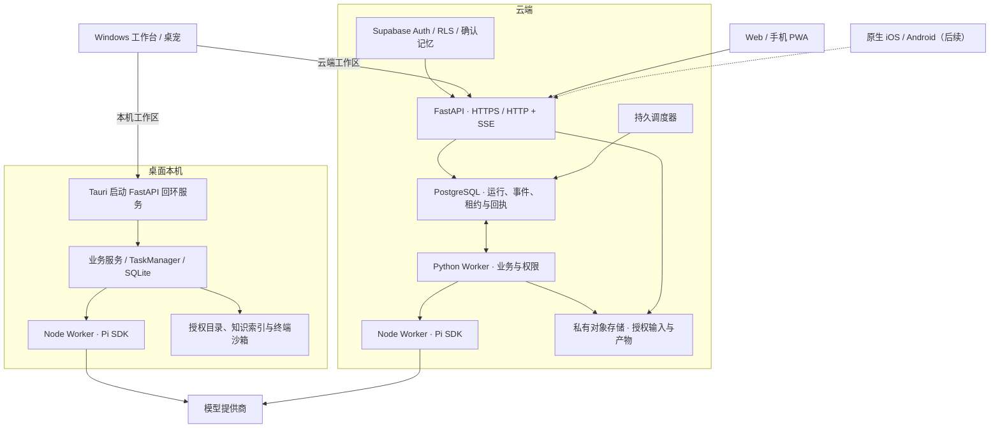

# 云端与多端架构设计

tebb 继续推进个人工作台的本机、云端与多端路线。原 #314 的多成员协作实施归 MyAgentDesk，产品边界和联动见 [tebb 产品边界](PRODUCT_SCOPE.md)。

2026-11-12。目标架构和实施验收计划。

同一账号可从 Windows 或手机访问云端工作区。用户从手机提交云任务，离开页面后云端继续执行，在 Windows 上打开同一个运行可查看完整进度和产物。Windows 另提供本机工作区，负责设备数据和本机工具。

本设计以现有 Tauri、Python 业务服务、任务系统及 Supabase 账号与确认记忆同步为基础。Agent 循环、流式模型调用和模型工具协议使用官方 Pi SDK。此决定替代 #293 早期的 LangGraph / LangChain 方案。

## 目标架构

桌面提交前明确选择本机或云端工作区。运行 ID、所属账号、执行位置、输入快照和策略在入队时固定。客户端在原执行位置查询和恢复。后续如需云任务调用设备能力，另行设计设备主动连云、按次授权和离线等待的执行通道。

## 服务职责与数据归属

| 组件 | 职责 |
| --- | --- |
| 桌面、Web 与移动端 | 共用版本化请求与事件契约。客户端选择工作区、提交或取消任务、补读事件并展示结果。移动端首版建议采用响应式 Web/PWA，原生端复用同一 API。 |
| 本机 FastAPI | 只绑定回环地址，由 Tauri 启动并持有进程 Token。沿用按账号划分的运行进程、短期预览凭据、受限素材访问及终端交互。 |
| 云端 FastAPI | 验证 Supabase 访问令牌及账号、工作区归属。负责请求校验、入队、查询、取消和 SSE。服务端为每次操作核验权限。 |
| Python 业务服务与 Worker | 保留工作流版本、条件分支、任务预算、协作交接、工具权限、用户确认与外部回执。现有工作流解释器执行确定性业务节点，AI 节点调用 Pi。 |
| Pi SDK 与进程适配 | Node 执行官方 Pi Agent Core 的 Agent 循环与工具调用。Pi AI 负责 provider、流式调用及模型事件。适配层只映射输入、工具、事件及取消，业务策略和持久状态由 tebb 管理。 |
| 本机数据 | 本机任务、历史、项目目录、原始知识索引和凭据归设备与账号空间，SQLite 继续保存本机任务和回执。 |
| 云端数据 | 复用 Supabase Auth、PostgreSQL / RLS 和 #255 的确认画像、偏好与记忆同步。云端工作区单独保存新建会话和任务。显式上传输入、云任务产物进入私有对象存储，访问前核验归属。 |

旧本机资料默认留在原账号空间。确认记忆按既有版本、幂等操作、设备游标和删除墓碑同步。云侧模型与连接器使用独立配置的服务端凭据。本机进程 Token 与云端账号令牌分别服务于各自的信任边界。

## Pi SDK 的接入

- 本机与云端复用同一份 Node 适配代码。Python Worker 以私有进程通信传递经校验的模型、消息、工具清单、取消信号和事件。按运行隔离模型配置、工具授权和子进程生命周期。进入迁移时锁定 Node 和官方包版本，并将可执行运行时及依赖纳入候选包与云镜像。
- 有工具的对话和协作使用 @earendil-works/pi-agent-core，单次推理节点使用 @earendil-works/pi-ai。模型传输、输出及思考流、用量和工具循环来自 Pi。迁移目标不引入 LangChain、LangGraph、LangMem 或自研通用 Agent 框架。
- Pi 仅收到该运行允许使用的工具定义。工具回调交由现有 tebb 权限和业务入口执行，文件和命令继续通过既有隔离服务。云端首版只注册云侧已授权工具。预算在模型调用或工具执行前检查。模型凭据、原始请求和工具参数按既有规则处理，日志保留最小可追溯信息。
- 以现有对话和工作流记录作为权威数据。按 Pi 官方消息类型映射历史及完整工具轮次。只有核实支持的字段才进入新模型上下文，原始记录继续可查。进程退出、超时或取消必须形成可核对的运行状态，迟到事件不得改写终态。真实提供商代理、扩展推理字段和已支持配置的兼容性由本机迁移阶段验证。

官方接口见 [Pi Agent Core](https://github.com/earendil-works/pi/blob/main/packages/agent/README.md)、[Pi AI](https://github.com/earendil-works/pi/blob/main/packages/ai/README.md) 和 [FastAPI SSE](https://fastapi.tiangolo.com/tutorial/server-sent-events/)。

## 跨端运行与恢复契约

| 行为 | 目标契约 |
| --- | --- |
| 提交 | 通过 HTTP 提交稳定 request_id。按账号、工作区与请求编号去重。相同输入返回原 run_id，同一编号对应不同输入时返回冲突。入队和登记去重记录在同一事务完成。 |
| 查询与订阅 | HTTP 查询运行快照，SSE 按 run_id 读取事件。事件在单次运行内单调编号，重连使用上次游标并按序号去重。游标过期时获取带事件水位的快照，从水位继续读取。 |
| 取消与故障 | 客户端显式取消，断网和退出页面只关闭订阅。云 Worker 按租约领取运行，通过租约代际阻止旧 Worker 覆写当前状态。到期恢复从持久记录判断下一步。 |
| 外部写入 | 写入前持久登记操作编号与确认依据。已确认的操作跳过。未知结果通过原编号核对，核对前暂停该步骤，避免重启或重试造成重复写入。调度器按计划及触发实例去重。 |
| 观测 | 贯通账号、工作区、run_id、事件序号、模型调用及外部操作编号。通过受控接口读取快照、事件、预算、回执和产物，支持隔离环境中的自动化验收。 |

## Agent 验收契约

Pi SDK 执行模型与工具循环。tebb 通过现有工作区、工具授权、沙箱、运行记录和调试入口提供下列验收能力。验收者应能拿到固定用例并独立复跑。

- **项目上下文。** 用例提供需求来源、选定账号与工作区、仓库及提交或工作流版本、目标环境、用户操作路径和预期结果。项目指引用于定位原始来源和业务约束。通过调用检查台或运行证据核对本轮实际采用的来源与版本。发现必需资料缺失、未获授权或相互冲突时，指出具体缺口并停止依赖它的步骤。任务发现的可复用经验可以提交给维护者评审，合入后才成为项目指引。
- **自主验证。** 复用现有认证入口与隔离环境。每个用例交付可复制的命令或真机步骤、固定输入、故障注入点和预期观察值。由 Agent 或可供 Agent 调用的脚本执行正常产品链路，直接取得业务结果、日志和产物。故障修复用例保留修复前的失败信号，并在交付版本上用同一用例重跑。HTTP 成功、命令退出码为零或模型自述完成只能证明对应环节，最终判定以实际业务结果为准。
- **证据留存。** 用例证据至少记录输入来源与版本、环境和候选版本、request_id、run_id、步骤、预期值、观察值和逐项结论。通过受控查询关联关键事件序号、验证命令与输出、模型调用或外部操作回执及产物，适用时附真机截图或录屏。保留首次失败和重跑记录，区分模拟、真实模型与真机结果。缺关键证据的用例标为待核对，公开记录使用脱敏证据。
- **任务恢复。** 在已知检查点断开客户端、终止进程或注入回执丢失，再按原运行和操作编号核对。分别验证只读接续与显式续跑。已有确认的步骤跳过，结果未知的写入先核对，等待确认的步骤只有收到匹配确认才继续。以运行记录、事件及实际目标侧写入次数核对恢复结果。

来源：[吴佐衍的企业级 AI 研发提效实践](https://mp.weixin.qq.com/s/nGSsiw4tn21Yt-shlOvP1A) · [tebb 调试与验收入口](AGENT_DEBUG.md) · [开发团队的验证证据](DEVELOPMENT_TEAM.md)

## 实施与验收

### 1. 本机后端迁移

依赖当前 Windows 候选包基线、现有工作流与任务契约、可在候选包中交付的 Node 与 Pi SDK。先做模型兼容样例，再切 FastAPI HTTP/SSE。依次迁移可视化工作流 AI 节点、普通对话、多伙伴协作及其他生产调用方，最后清理旧 WebSocket、Atlas 依赖和打包逻辑。工作流迁移保留已保存版本、原定时绑定和节点回执。

验收覆盖桌面、桌宠、预览及飞书入口，验证鉴权、账号切换、笔记问答断线去重、事件补读、取消及进程清理。用模拟提供商检查 Pi 工具循环、用量、思考流、完成原因和异常。用代表性真实模型验证代理、扩展推理字段与多轮工具交互。工作流恢复通过模拟外部写入丢回执验证。无全局 Node/Pi 和 Atlas 的干净 Windows 可运行候选包，升级保留数据，完整 CI 通过并演练回退。[#293 本机后端迁移](https://github.com/lkun-lea/tebb/issues/293)

- [ ] **项目上下文。** 准备一个固定的 GitHub 测试 issue 和两个含同名文件的工作区。从 Windows 候选包选中已授权项目提交，核对 Agent 引用的 issue、仓库、版本和复现入口均指向该项目。撤去一份必需资料的权限再跑，Agent 说明缺口，运行记录中没有越权读取或使用另一工作区的内容。
- [ ] **自主验证。** 通过候选包的认证入口提交一个可稳定复现的缺陷。在授权的隔离项目环境中由 Agent 运行复现命令、读取失败输出、修正并重跑同一场景。验收者独立复跑命令并看到预期业务结果，过程无需人工搬运日志。
- [ ] **证据留存。** 按 run_id 查询固定 issue、候选版本、修改前的失败和修改后的通过记录，能关联实际命令、退出码、业务断言、输出与适用的工具回执。重跑保留首次失败。
- [ ] **任务恢复。** 在测试工作流进入写入确认等待时重启本机后端。用原工作流运行 ID 查询并显式续跑。已完成节点跳过，确认前目标侧写入次数为零；提交匹配确认后继续，模拟目标只收到一次写入。

### 2. 云端上线

依赖 #293 的协议和 Pi 运行时通过迁移验收、#255 的账号与同步能力，以及 #263 的真实登录投递验收。测试部署可提前准备。首版建议采用 FastAPI、独立 Worker 和调度器三个进程，以 PostgreSQL 持久化队列及事件，配合私有对象存储。云端首批提供普通对话、获准的工作流与定时触发，以及 Windows 云端工作区。上线前确定环境、TLS、配额、备份保留和运维归属。

验收在实际 HTTPS 环境完成真实登录与双账号隔离验证。Windows 提交后退出，云端完成任务，重新打开可按原运行 ID 读取进度与产物。注入 Worker 崩溃、重复定时触发和 API 重启，检查恢复、去重及未知写入。实际验证授权下载、监控告警、备份恢复和回滚，留存至少一条真实模型业务结果及对应回执。[#312 云端上线](https://github.com/lkun-lea/tebb/issues/312) · [#263 SMTP 与真实登录](https://github.com/lkun-lea/tebb/issues/263)

- [ ] **项目上下文。** 用账号 A 在云端工作区提交引用固定版本的测试资料的任务。核对运行记录只采用获准来源。用账号 B 请求 A 的运行、资料与产物均被拒绝；请求桌面专属工具时明确返回不可用。
- [ ] **自主验证。** 用 Agent 可调用的脚本通过测试环境的 HTTPS 入口提交固定云工作流。由实际 Worker 执行已授权测试工具，脚本自行读取运行与产物并核对约定结果。保留通过和注入错误各一次，验收以产物内容或测试目标的实际状态为准。
- [ ] **证据留存。** 重启 API 后按原 run_id 仍能查到脱敏的输入版本、执行环境、事件、模型调用、操作回执及产物。验收者可从证据回溯实际失败点与恢复后的结果。
- [ ] **任务恢复。** 在模拟外部服务收到写入、Worker 尚未保存最终回执时终止 Worker。恢复使用原 run_id 和操作编号，核对前保留待核对状态；由模拟服务查实已写入后继续原运行。核对已确认步骤未重做、旧租约迟到结果未覆盖当前状态、目标侧实际写入次数为一。

### 3. 移动端接入

依赖 #312 的云端服务、可用的云端测试账号和 Windows 云工作区。手机端提供登录、云对话、任务提交和取消、状态、错误与产物查看。首版建议采用 Web/PWA。原生应用、系统推送和设备远控另行排期。

实体 iPhone Safari 与 Android Chrome 验证登录、切换账号、输入、提交、取消和授权下载。手机提交后关闭页面，Windows 在同一账号接续原运行，手机再次打开时恢复至同一状态。通过弱网、重复提交、过期游标和账号切换验证事件与正文去重、缓存隔离、跨账号拒绝和错误恢复。记录设备、浏览器、云端版本及 run_id。[#313 移动端接入](https://github.com/lkun-lea/tebb/issues/313)

- [ ] **项目上下文。** 在手机选中云端工作区并提交带来源的固定任务，Windows 用同账号打开该运行。对比两端工作区和运行引用的资料版本。切换到另一账号并注入旧订阅迟到事件，确认两端各自的界面和查询只返回当前账号获准内容。
- [ ] **自主验证。** 提供 Agent 可调用的浏览器验收脚本，自动提交任务、注入断网与过期游标、恢复并对照后端快照和界面结果。按同一用例在实体 iPhone Safari 和 Android Chrome 复验前后台切换与实际结果，分别保存脚本和真机结论。
- [ ] **证据留存。** 每台真机记录设备、浏览器版本、云端版本、request_id、run_id、断线前游标和恢复后观察值。保留手机与 Windows 的关键界面证据，并可用受控查询核对两端显示的最终结果与同一产物。
- [ ] **任务恢复。** 注入服务端已接收但手机未收到提交回执，再用同一 request_id 重试。手机离开页面，Windows 接续原 run_id。手机重开后验证有效游标按序补读、过期游标按快照恢复，服务端只登记一个运行，两端最终正文和产物一致，重复事件不重复显示。

## 现有项目契约

[开发指南](DEVELOPMENT.md) · [工作流](WORKFLOWS.md) · [账号](ACCOUNTS.md) · [确认记忆同步](PERSONALIZATION_SYNC.md) · [Agent 调试与验收](AGENT_DEBUG.md) · [CI/CD](CI_CD.md)
