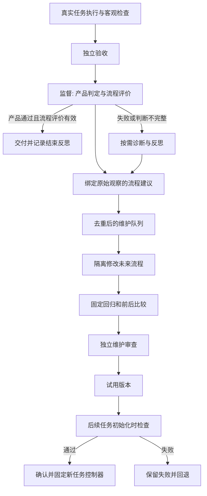
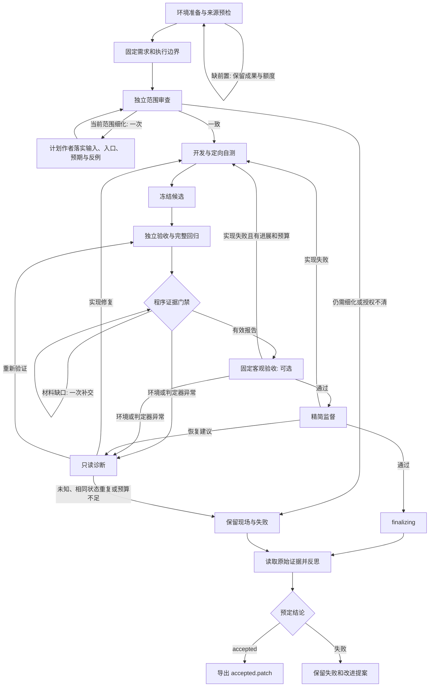
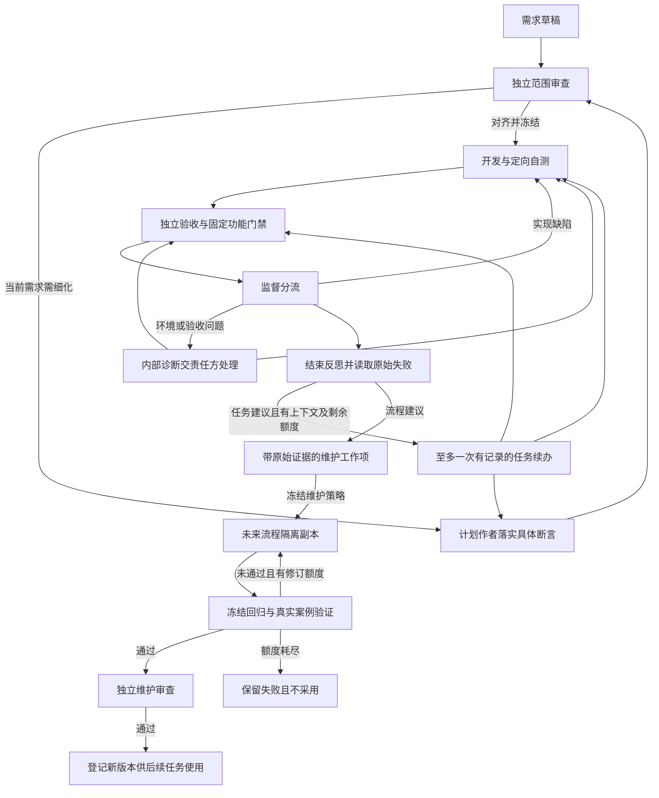

# 本地开发验收闭环

用于外部 Codex 按一个已确认的 issue 开发 tebb，不是 tebb 产品内的 Agent/Atlas 执行器。先在单项需求上验证流程，再考虑接入依赖排序和连续领取；本地候选通过不代表已合入或发布。

## 当前目标版本策略

当前控制协议为 v10。成功路径为“需求对齐 → 开发 → 客观测试与独立验收 → 监督兼结束反思”。已有确认契约跳过需求生成；开发续修沿用同一会话，独立验收保留独立判断。监督的 `process_review` 已读取原始失败与成本，产品通过且流程评估有效时直接交付并导出维护提案，不再调用第二个反思模型。完整无返工路径由6次模型阶段调用减为5次；已有确认契约由5次减为4次。这是调用数变化，不能直接等同于实际 token 或费用下降比例。

失败、流程评估 unknown 或引用无效时保留单独反思，不能把删步骤变成隐藏问题。产品判定负责交付，流程判定记录返工、重复验收和实际用量；有效流程建议直接进入维护候选，未知观察不作为已证实维护依据。统一导出函数负责反思记录、提案和交付补丁，原始监督结果不改写。历史任务继续使用原先封存的控制器。

保持最小职责：模型负责实现和判断，控制器负责状态、证据清单、来源校验、计量和版本选择。正常任务不额外安排诊断；有具体故障才进入已有恢复分支。同一个问题不启动多个维护任务，不递归自改进，不为此次局部维护再添加需求、规划、监督和反思模型。每次只改一个可复现机制，先固定验收，再执行“维护开发 → 固定验证 → 独立审查 → 后续任务试用”。没有收益证据就保留为试验结果，不默认推广。

自动维护必须在初始化时提供 `--improvement-policy`，包含冻结源包、可修改路径、维护预算，以及 `regression`、`comparison`、`canary` 三份固定验证计划和必需检查名称。未配置时提案只排队，不宣称自动优化。相同责任方与相同原始观察集合的提案合并并保留来源；门禁错误完整交接，不在第600字符处丢失后续问题。

维护模型在隔离包内实施改进，控制器执行回归和前后比较，独立维护审查通过后生成 `trial` 版本。下一个通过同一策略初始化的任务先执行固定试用检查；通过后确认版本，失败则记录回退并恢复先前已确认版本或基线。策略、源观察、验证和审查证据均核对哈希，未观测的“通过”不构成采用依据。采用与试用回执被修改时拒绝使用。回退不改写历史任务成绩。

首个真实自改进验证位于 `E:/Learn_Project/_work/self-improve216-r1`：使用 #216 原始交接记录，固定回归验证多引用错误聚合、原因区分和拒绝能力；真实模型对比另记调用与 token。确定性模拟的修复次数不能当作真实模型成本，单对样本不能证明普遍节省。`policy.json` 是该次局部维护的执行策略，`protocol.json` 记录冻结输入与预算，实际采用以 `maintenance/active-release.json` 及试用回执为准。

首轮的比较任务将临时环境联接放入证据目录，比较通过后封存被拒；该失败保留。`E:/Learn_Project/_work/self-improve216-r2` 修正宿主布局：真实比较任务存放在独立执行目录，证据目录只保存原始记录的普通文件副本及来源哈希清单。两轮共享原维护4次CLI总预算，不退还失败调用；监督真实回放建议和原反思建议合并进入同一维护任务。宿主修复属于外层干预，应与维护模型自行修改流程的结果分别报告。

r2 的维护模型、固定回归、真实交接比较和独立维护审查均通过，但控制器拒绝了审查报告引用的提案观察及开发证据，原生维护结果仍为 `blocked`，未生成已采用版本。两轮共4次维护CLI，加交接对照与监督回放共8次；实际采用和新任务试用尚未真实完成。完整评估见 r2 的 `evaluation.json`，不得把审查模型的 pass 当作控制器采用成功。

维护交接的后续修正由控制器在审查前生成精确文件清单，封存候选、验证结果、当前开发证据和提案来源。审查只能引用清单中的非空文件；可选 `historical_evidence=[{"path":"绝对路径","sha256":"已知哈希"}]` 明确加入历史上下文，不允许审查结束后依照报告任意扩充可信路径。采用前再次核对全部封存证据。该修正的本地回归与原报告回放不改写 r1/r2 结果，也不等于已完成新的真实自动采用。

**v10 定向闭环已在 r3 跑通。** 用户进一步授权以目标和简洁为先后，新试验 `E:/Learn_Project/_work/self-improve216-r3` 使用冻结 v10 基线，真实维护模型只修改 `Cycle.evidence` 函数体并添加定向回归。固定回归、真实交接比较和独立维护审查通过，控制器自动登记版本；随后通过真实 CLI 初始化新任务，试用检查将版本从 `trial` 确认为 `confirmed`，新任务固定的控制器与采用包逐文件一致，其实际证据门禁通过留出检查。主工作区随后同步了该已验证函数和测试。试验执行期间外层修复为0；试验前的控制器证据清单修正和监督合并属于主会话实施，不能算维护模型自行发明。完整原始证据见该目录 `evaluation.json`、`activation-result.json`、`main-application.json`。

本轮3次真实CLI（维护开发、交接比较、独立维护审查各1），输入1,054,938，其中缓存918,528、未缓存136,410，输出17,893。连同前两轮失败，累计11次CLI、未缓存输入442,825、输出62,464；主会话实施用量和费用未知，不能填0。本轮只重用旧对照、不重复计为新调用。真实交接两臂都一次补交通过，尚未证明减少真实返工；新臂未缓存输入16,027、旧臂30,697，输出分别5,177和5,124，仅为一个已知案例，不证明普遍节省，更不证明已摊平维护成本。确定性模拟的两次修复降为一次另行记录。

验证范围是已知 #216 失败机制的自动维护、采用和新任务控制器实际执行，不是第二个完整新 issue 的真实开发。r1/r2 原生 blocked 和原 #216 交付记录保持原样。本次局部策略仅授权一个维护任务，不是无限自动维护授权；没有新观察和固定验证依据，不为追求“自优化次数”增加模型环节。

本地分组回归覆盖135个不同测试。首组110项中100项通过，10项仍依赖旧调用数、独立反思入口或尚未覆盖提前导出补丁的Git替身；同步当前协议后10项均定向复查通过，监督、证据门禁和维护采用另有分组验证。首次失败日志保留，不表述为一次冻结全量通过。`validation.json` 记录每组日志、哈希及复查覆盖，并核对主源码全部流程模块与已采用版本逐字节一致、原始任务记录未变。



只面向当前需求与目标版本，不兼容旧版本。不新增或维持仅服务旧版本的适配层、旧协议回退、双轨实现、双写和迁移分支；接口变化同步修改当前调用方、测试及文档，清理本次被替代的旧实现。现存旧代码或旧测试不自动产生兼容需求。当前需求仍使用的业务行为、权限与用户数据边界继续遵守，不扩大为无关重构或删除。

该规则同时写入仓库 `AGENTS.md` 及需求、开发、验收、补交、监督的阶段指令；反思知道这是已有策略，不重复提案。规则由模型执行和审阅，不宣称静态门禁能自动识别一切历史兼容代码。

## 真实 issue 历史回放评估

使用 issue 修复前的准确提交、对应历史修复，以及从同一基线独立开发的新结果，交给同一份事先冻结的宿主验收。历史实现是比较对象，不是唯一正确答案；比较需求行为、回归、改动范围与实现冗余，不能以补丁相似度评分。

回放源码通过 Git archive 导出后重新初始化为单提交仓库；核对 tree hash 等于原基线，不沿用包含后续答案的完整 Git 历史，不复制主工作树未提交内容。提供原始 issue 的需求与已确认范围，剔除后来补写的修复和交付说明；模型禁止访问后续提交、上游 issue 更新及目录外历史实现。宿主独立验收文件不交给开发者，阶段执行记录供事后核对。该方式减少答案泄漏，不宣称是完整的文件系统保密隔离。

调用前固定题目、代码和流程哈希、验收探针、轮数/调用上限、进展检查间隔及停止条件。v3不按阶段或总耗时终止任务；历史试验中的时间上限仅描述旧版本当时设置。保留全部阶段和失败；代码行为合格与流程接受分别记录，不用放宽契约覆盖阻塞。历史真实用量、有效开发耗时缺失时标未知，不能根据 Git 时间差宣称成本降低。单例历史回放不是随机 A/B，也不能估计一般成功率。

已关闭 issue 用本地 issue 快照初始化，不重新打开或修改远端。首例驱动和冻结材料位于工作区旁 `output/dev-cycle-issue-204-20261101/host/`；驱动拒绝覆盖既有记录，不自动重试模型。回放还需明确区分本次可执行验收与原 issue 中关联事项的后续安排，避免把下游工作扩大为本次交付条件。

## 运行

需要 Python 3.11+、支持 `--python` 的pip、项目现有 `jsonschema`/`psutil`、Git、已安装并登录的 Codex CLI。首次 live 前准备任务私有依赖并完成导入预检；模型选择沿用本机配置，不擅自切换模型。

任务目录放在源仓库之外。推荐先用一个小范围、无真实外部写入的已确认需求；以下命令在仓库根目录运行：

```powershell
# 用本地需求文件，不访问 GitHub；需求文件可包含原 issue 链接和已确认答案。
python scripts/dev_cycle.py init --repo . --issue-file E:/Learn_Project/output/issue-input.md --output E:/Learn_Project/output/dev-cycle-first
# 本机已验证 HTTPS 可绕过 WebSocket 重连等待；仅本任务沿用 OpenAI 登录/模型，不改全局配置。
python scripts/dev_cycle.py init --repo . --issue-file E:/Learn_Project/output/issue-input.md --output E:/Learn_Project/output/dev-cycle-https --openai-https
# 显式确认已有产品契约适用于本次需求/代码基线，校验后跳过需求模型调用。
python scripts/dev_cycle.py init --repo . --issue-file E:/Learn_Project/output/issue-input.md --confirmed-contract E:/Learn_Project/output/confirmed-contract.json --output E:/Learn_Project/output/dev-cycle-confirmed --openai-https
# 或只读获取一个仍打开的 GitHub issue（需要已登录 gh）。
python scripts/dev_cycle.py init --repo . --issue 205 --output E:/Learn_Project/output/dev-cycle-205

# 用标准pip完整准备任务venv并预检；不调用模型。
python scripts/dev_cycle.py prepare E:/Learn_Project/output/dev-cycle-first
# 可复用wheel缓存；offline仅从本地wheel安装。
python scripts/dev_cycle.py prepare E:/Learn_Project/output/dev-cycle-first --wheelhouse E:/Learn_Project/output/wheels --offline
# 明确启动真实 Codex，会消耗当前账号用量。每阶段先预检，缺少依赖不扣CLI启动额度。
python scripts/dev_cycle.py run E:/Learn_Project/output/dev-cycle-first --live
python scripts/dev_cycle.py status E:/Learn_Project/output/dev-cycle-first
# 只读查看当前进展；另一个终端可在运行期间调用。
python scripts/dev_cycle.py progress E:/Learn_Project/output/dev-cycle-first
# 显式取消，运行器在约1秒的控制轮询内停止本次进程树，不启动后续模型。
python scripts/dev_cycle.py cancel E:/Learn_Project/output/dev-cycle-first
# 历史回放明确本次目标；监控参数是检查/提醒间隔，不是任务期限。
python scripts/dev_cycle.py init --repo E:/Learn_Project/output/frozen-source --issue-file E:/Learn_Project/output/issue.md --output E:/Learn_Project/output/replay-v3 --purpose historical_replay --goal "仅修复当前issue并做本地受影响回归" --check-seconds 120 --silence-seconds 600
# 调试时只完成一个阶段并落盘；之后普通 run 继续，预算不重置。
python scripts/dev_cycle.py run E:/Learn_Project/output/dev-cycle-first --live --one-stage
```

`init/prepare/status/progress/cancel/recover/observe` 不调用模型；prepare可以下载并在任务venv内安装依赖。不要重复使用同一个新任务目录；`init` 不覆盖已有目录。调度器须在本机终端持续运行，不是关闭聊天后自动常驻的服务；操作系统重启不会自动启动它。第一版不自动领取下一个 issue。异常通知写入任务 `notifications.jsonl` 并输出到运行器stderr；这是本地CLI通知接口，不是桌面后台推送。

`--purpose historical_replay` 标记任务用途，不自动导出历史代码；应先按回放规程准备无后续历史的单提交源码快照，再把该目录传入--repo。

## 状态与职责

当前新任务使用 v8，仍是显式启用的试点：环境预检 → 固定边界 → 需求草稿/已确认契约 → 独立范围审查 → 开发 → 控制器客观验收（若配置）→ 独立验收 → 程序证据门禁 → 监督 → 反思与交付。任何未通过的候选先交只读诊断，客观报告的 implementation 标签不能直接派发开发。保留成果和原预算，不设置阶段或总耗时硬截止。历史 v7 等任务记录不迁移、不回写成绩。

### v8 故障归属、验收器修订及证据复用

- 诊断绑定当前 candidate、contract、acceptance_plan 和 failure_fingerprint；只有独立验收已明确判定为 `fail/implementation` 的正式条件，且诊断确认产品原因，才允许产品返工。验收争议、环境受限和未知不能靠重新贴标签消耗开发轮次。
- 客观报告每项必须包含 `name/passed/observed/failure_type/criterion_ids`。实际行为尚未执行不能判 implementation，通过项必须实际观察且无故障。报告可保留混合故障，不能用整体退出码代替逐项归属。
- 控制器先执行客观测试。独立验收核对同候选原始输出、业务事实和封存回执，不重复执行已完成的整套测试；确有缺口才定向补验。模型可引用控制器已封存的原始文件，无须复制大日志。
- 回执绑定候选、契约、验收器版本、解释器/依赖环境及工具身份；记录和原始证据全部哈希核对。Node依赖校验实际包文件内容，排除 `.vite/.cache` 等派生产物；拒绝指向任务外的依赖链接。按外部写入阶段与客观测试边界重新核对，指纹扫描提供检查点和取消入口。任一相关输入变化失效。同候选恢复可以复用；跨候选默认重测，不能把旧候选通过记录直接挪来。本版不宣称已经实现任意依赖闭包的自动增量复用。
- 同环境实际观测到的执行限制带原始报告传入后续阶段；候选未变时复用干净的 review，不重新克隆或广泛扫描。旧验收交接仅提供最近两轮的精简矩阵、来源哈希和原始路径。
- 允许修订的验收器须在初始化时提供 `revision_policy`：冻结包 `root`、可改文件 `editable`、不可改的 `calibration_argv`、包含 `positive_` 和 `negative_` 名称的 `required_controls`。例如只允许修订 `oracle.py`，校准器与正负输入保持封存。
- 可用冻结 `prepare_argv` 准备工作/验收副本的依赖，先准备再绑定执行环境。准备回执不等于产品通过；失败保留环境阻塞和原始输出，不消耗模型启动。判定包拒绝未封存文件及 Python 字节码；采用记录同时封存校准和独立审核证据。
- 已确认验收器问题走 `evaluator_repair → 固定正负例校准 → evaluator_review → 采用记录 → 同候选重新客观验收`。作者只写新副本，审核者只读。校准失败、弱化负例、增删冻结文件、修改封存控制或缺少独立审核均不能采用。旧脚本、旧失败、旧合法评分和业务契约均保留；采用链校验后才切换活动验收版本。
- 开发最多3轮，CLI默认20次，保留反思额度。验收器修订最多2次，计入总CLI、不增加开发轮次。不提供新候选、执行条件或验收版本的相同恢复动作会终止本轮并保留原因；不无限重试。
- 客观测试期间 `progress` 输出当前运行记录和检查点，进程存活只表示在运行，不等于功能通过。Token报表另列诊断、验收器修订、回执交接与复用计数。根对话、额外可用性探测及外层交付成本必须单列，缺失不能填零，也不据单例声称节省。

v8 不热替换当前控制器；流程维护仍复用已有独立维护队列、冻结回归、审查和未来版本采用机制。验收器在已授权范围内的修订与流程自身升级分别留痕。

v7将当前范围细化交给只读verification_plan作者，输出具体输入、执行入口、预期结果和失败反例，再由独立范围审查复审。意见标识opinion_id与正式criterion_ids分别保存并绑定；确认稿不改写。补交保护合法条件原判定，剔除额外编号仍保留全部原始意见；额外失败/未知及合法条件判定冲突交诊断，不静默删除刷绿。验收输出Schema按当前契约限制编号。普通开发入口不受该试点影响。原v6三例失败仍保留在后文，不回写通过。



- 初始化固定 `execution-scope.json` 及哈希，记录本次目标、implementation/historical_replay用途、仅本地执行、无外部写入和下游计划不自动阻断。每阶段核对原issue和边界未改。当前版本不自动授权产品真实模型/SDK、远端CI或发布。
- 需求 ready 后先保存 `draft-contract-N.json`。复用监督角色做一次独立 `scope_review`，逐项核对当前/后续/未授权/不明确、执行类别、原始逐字来源及业务覆盖，调用计入总预算。程序校验草稿哈希、条件全覆盖、来源确实存在；aligned不得包含后续或非本地执行。语义归属和遗漏仍由模型判断，不能把逐字引用当作语义证明。
- 普通草稿最多按具体范围反馈修正一次，保留两稿及两次审查；仍不一致停止。真正歧义进入needs_input，必要但未授权执行blocked。范围通过后才写 `contract.json` 和SHA256，之后不可降低标准。关联issue的当前必要规则仍需保留，非阻断后续事项保存在审查报告deferred。
- `--confirmed-contract` 使用同schema、ready且无待解决问题，跳过需求生成但不跳过范围审查；确认稿不会自动改写；当前范围内的意见交verification_plan作者逐条落实并绑定现有条件，再审最新计划。缺失意见、伪造来源或新增评分编号拒绝。仍不一致时保留失败并反思。原文件后续修改不改变任务内副本。`constraints` 只记录产品约束，角色权限保存在独立 `role_policy` 中。
- 开发副本从源仓库的 HEAD 创建，不包括源工作区未提交修改。远端被移除，不向用户工作区推送。调度器提交每轮不可变候选；开发 Agent 不自行提交/推送。主仓库缺少的个人配置不会隐式复制到副本。
- 每轮验收在新的候选副本、新的模型会话中执行；可以写自己的证据目录和 Git 忽略的构建产物，修改源码/测试会被检测并拒绝。验收条件必须逐项出现，pass/fail/unknown 与环境/实现/需求/验收器错误分开。
- 验收/监督的 evidence 是结构化对象：`{"path":"纯绝对路径","observation":"实际观察"}`。程序检查文件归属、存在和非空；解释不能拼进路径，也不猜测或截断错误路径来放行。
- 开发只做定向自测和冗余检查，独立验收负责受影响层完整回归。监督不重跑测试/构建、不重新探索仓库；反思不重读全量历史。监督和反思在无源码的只读 `briefs/` 工作目录运行，默认根据程序准备的交接包回答，有明确异常时才回查指定原始证据。
- 监督输入产品契约、同版候选差异（正文最多12000字符）、验收矩阵和证据索引（路径、完整SHA256、文件长度、最多8000字节的总摘要）；过长内容标 truncated，原证据仍可回读。模型建议 pass 不能越过缺项、未知项、错误版本或不存在证据的程序门禁。只有明确 implementation 失败可以自动回到开发；需求缺口进入 `needs_input`，环境/验收器问题进入 `blocked`，本次不自动修改契约或评分规则。
- 开发首次使用新会话，修复按明确的 developer session ID 恢复；其他角色每次新建会话。各角色可按需回读原始证据，不复制整段开发对话。`--last` 不用于恢复。
- 最终反思先接收阶段状态、耗时/用量和失败观察索引，不默认收到原 issue、完整契约、整份 state 或人工编写的失败原因。存在失败观察时，必须主动通过只读 observe 接口回查相关断言/原始输出/修订记录，再给出有出处的判断。只产出 observations/proposals/validation_plan，不自动修改流程、AGENTS.md 或评分器。反思失败不会将已验收的产品改判成功/失败。
- 每次实际调用落盘 `packet.json`、包哈希、prompt字节数及既有原始日志，便于检查输入内容与载入成本。缩小交接包不等于控制了 Codex 全局基础指令和技能目录；实际token以CLI回报为准。

### 固定客观验收与故障归属

初始化可用`--acceptance-plan`指定宿主冻结的JSON，包含`argv`数组和`files`（绝对路径到SHA256）。占位符`{python}`、`{candidate}`、`{result}`分别替换成任务解释器、不可变候选和结果路径；不执行shell拼接。判定器写非空唯一checks及status/failure_type，运行前后核对文件哈希，保留命令、退出码与stdout/stderr。实现失败返回开发，环境/判定器异常先诊断，不能覆盖原验收报告或把未知当通过。未提供计划时，这一宿主门禁不执行。

开发会话连续，其余审查上下文独立。每轮Codex执行都显式配置当前证据目录写范围；恢复不依赖CLI继承额外目录，不开放任务状态或旧回合证据。进度检查只接受当前源码、当前记录和明确指定产物目录中的实际文件；重复声明、时间戳、其他任务或旧回合文件不构成新进展。

### 用量、返工与流程改进

每次保存同时生成metrics.json：输入、缓存输入、未缓存输入、输出、CLI启动数、候选提交数、补交/恢复/细化次数及缺失用量。当前已验证CLI的turn.completed用量是会话累计值；恢复按session高水位取增量，不把多次累计值相加。缓存已包含在输入，推理已包含在输出；费用未知，不据token数估算账单。CLI升级后须重新核对计量语义。

评测另外统计开发调用数和额外开发调用，包括已有修复但交接失败的回合，避免只数候选漏记返工。同等功能和交付质量下比较token及返工，未开发就blocked不能算零返工优势；失败、流程维护、验证探针均计入已记录消耗。主聊天用量未取得，不能将本地执行器总数说成完整账单。

反思输出结构化提案：kind、owner、原始observation_ids、action、expected_result、regression；终止位置与带来源评分差异作为事实输入，不替模型给出因果结论。每次反思保存不可变观察快照和提案快照。能力列表只表示已有实现，证据显示失效时应提出机制修复。

任务级提案在blocked、存在相应执行上下文且额度允许时派回计划作者/开发/验收，最多一次反思后跟进，沿用原契约、开发轮数和CLI额度。通过任务不会仅因反思建议而重开；没有证据、授权或可执行上下文的提案保留具体责任方，不伪称执行。

流程级提案自动进入improvement-jobs，提供冻结的improvement_policy时由正常run命令自动消费。维护只改未来隔离包中的allowed_paths，先过冻结的原始反例红绿与既有回归，再过真实案例比较，最后独立maintenance_review；缺任一证据不能采用。允许同一维护任务有限修复验证失败，不能修改验证器、策略或旧成绩。采用写入策略根active-release.json，后续使用同策略初始化的新任务选择该版本；正在运行的任务通过runtime.json固定自己的控制器副本，不被热替换。

### 一次受限的材料补交

首次验收的 JSON/schema、条件覆盖、绑定字段或文件证据门禁失败时，可以进入独立 supplement 阶段；任务全程共一次，不随开发轮次或恢复重置，消耗原来的启动预算。网络/进程失败、候选源码或测试被篡改不会自动进入补交。

补交只处理具体 gate_errors，复用已存在证据或最小采集缺失证据，不重做开发、不重跑已完成的整套验收。此前有效条件的 status/failure_type 必须保持，旧证据完整哈希必须不变；原报告和门禁错误保留。补交仍未通过即 blocked，不因“格式修复”提高成绩。已有原始分数不完整或有实质矛盾时，如实停止，不让补交代替重新评测。

### 失败观测：原始来源可查询

程序在保存阶段状态时自动维护 `observation-index.json`，由 `scripts/dev_cycle_observation.py` 负责。登记验收失败/未知条件、非零退出、阶段错误、材料门禁拒绝、环境阻塞、需求缺口及后续修订；阶段正常结束但验收失败也会登记。每项有稳定O编号、阶段/轮次和原始文件来源，不调用模型生成“失败摘要”。

反思只先看到索引与当前已有能力。发现失败后，使用包中的 `observer_command` 查询至多3项原始观察，通常一次、最多三次；每次默认6000字节，上限12000，索引可以分页。成功且无失败观察时仍默认不调用工具，不需要常驻一个模型观察全部执行过程。

```powershell
$cycleTask='E:/Learn_Project/output/dev-cycle-v2-batch-20261031/candidate-rollback/task'
$observationList=python scripts/dev_cycle.py observe $cycleTask --limit 12 | ConvertFrom-Json
$firstObservationId=($observationList.items | Where-Object kind -eq 'failed_check' | Select-Object -First 1).id
python scripts/dev_cycle.py observe $cycleTask --ids $firstObservationId --max-bytes 6000
# 对 command_nonzero 项可仅查看实际命令输出末段；长内容也可用 --source-offset 续读。
# python scripts/dev_cycle.py observe $cycleTask --ids O-实际编号 --output-only --tail
```

`observe` 是只读入口，不启动模型、不执行测试、不更改任务状态/原始成绩。没有索引的历史任务可以从原文件派生索引并在内存中查询，不回写旧任务。来源包含JSON字段选择器或JSONL原始行号及内容哈希；读取前校验哈希，来源改变、缺失、越出任务目录或内容被截断时如实标记未知/截断，不使用后来改写的内容证明原失败。

验收者的 failure_type 是模型分类，非零退出也可能是预期红测，都不能直接证明根因。反思须引用读取的O编号，区分观察事实、假设和未知；它可以从断言看到“未乘数量导致结果不符”，不能仅凭这一点断言发生了外部故障注入。现有能力清单用于避免重复提出已经实施的结构化路径或补交规则。

成功状态 `accepted` 同时输出 `accepted.patch`（含新增文件/二进制差异）和候选 SHA，供主开发会话检查后按既有策略提交。不会自动合入、推送、关闭 issue 或发布；源 HEAD 后续变化时必须检查补丁适用性，并重新验证受影响结果，不能用旧验收证明重做后的代码。第一版通过不等于已上线。

## 限额与停止

默认首次实现 + 最多两次产品修复，`--rounds` 仅允许 1..3。v8所有模型阶段共用默认20次 **Codex CLI启动**，可用 `--max-launches 5..20` 设置；这不是内部模型请求次数。客观进程不消耗模型调用，诊断及验收器修订/审查计入总调用，反思保留额度。验收器修订最多2次且不增加产品轮次；达到任何预算均保留候选与原始失败，不擅自追加或重置额度。

程序为反思保留一次阶段调用。达到开发轮数、相同失败条件且候选代码树连续不变、启动次数上限即停止。**不设置阶段或总运行时间硬期限**，已删除 `--stage-seconds/--total-seconds`；Python subprocess的短等待仅用于轮询并继续等待，不在耗时后终止。用户显式cancel/中断或实际进程错误仍停止；CLI内部自身的网络超时属于真实错误，不受控制器取消耗时上限影响。CLI usage原样保存，缺回报为未知；没有费用硬上限或跨CLI内部请求的精确token准入。

### 持续观测与进展反馈

默认每120秒读取JSONL执行事件、进展文件和进程状态；600秒缺少可核对反馈时，写 `progress-request.json` 请求具体成果，并核查进程及子进程存活。记录needs_check而非失败，保留原进程。相同异常期间只通知一次；恢复有效反馈后可在新的异常期间再次通知。普通运行无周期刷屏。

命令开始/结束是执行反馈，文件变更或有实际文件证据的新检查点是进展；泛泛agent_message、仅更新时间戳或更改说明而证据不变，不刷新有效进展。进程仍活着也不证明工作有效；长操作缺少新反馈时仍需核查，不自动判死或杀进程。未获反馈且无法确认时保留现场并通过CLI异常接口提醒操作者。

开发、验收、补交在安全节点主动写环境变量 `DEV_CYCLE_EVIDENCE_DIR` 下的 `progress.json`：

```json
{"completed":["已完成具体事项"],"current":"正在执行的操作","next":"下一步","blocker":null,"evidence":["本阶段源码或产物的绝对路径"]}
```

检查点可供查询、核对与接续决策，不代替最终结构化交接，不自动接管中断开发并判成功。当前单次 `codex exec` 中的询问通过文件在安全节点协作读取，不伪称支持向正在推理的模型即时插入消息。只读角色使用具体消息和已有只读命令反馈，不为检查点扩大写权限。原始日志、monitor.json及进展证据供反思按需回查。

开发产物放在任务 `development-artifacts/attempt-*`，初次开发会话只额外获得该目录的写权限；修复会话沿用相同权限，不传当前CLI resume不支持的--add-dir，不授予state或验收报告目录写权。其他可写角色只获得各自evidence目录。

### Python源码来源隔离

`prepare`通过标准 `pip --python <任务解释器> install -r ...` 在私有venv完整安装依赖，关闭system_site_packages和用户site。被测进程不再借用主机site-packages，也不执行主机editable .pth；任务venv内正常安装的依赖可执行自己的.pth和原生初始化。任务Python排在PATH首位，并通过任务级shell_environment_policy.set传给Codex工具；父子进程继承同一环境。

开发依赖依次读取候选的requirements.lock、requirements.txt、pyproject.toml的project.dependencies；不自动选用面向另一个Python版本的发布runtime-lock。`--dependency-path`仅用于固定Atlas等源码目录，其完整pyproject/requirements元数据一并参与依赖安装。只有代码、没有依赖声明的源码归档需由调用方补齐同提交元数据或相应依赖声明，不能以主机恰好安装代替。pip解析实际开发解释器可用版本，安装报告、发行包版本和依赖输入保存于environment/setup-*及python-env/environment.json；未锁定版本的输入不保证跨任务解析相同版本，严格复现应提供开发环境锁清单及固定wheel制品。

每个模型阶段前，预检同一任务Python的父子进程、项目导入搜索范围、desk_companion.tasks和已安装pywin32的原生加载。失败保存environment/*/result.json及原始stderr/install日志，状态为environment_blocked，当前stage、候选、轮数及CLI启动额度不变，不额外调用反思模型。补齐环境后prepare/run可继续原阶段；同一清单的未完成安装可续装，清单或解释器变化拒绝复用，旧失败记录不覆盖，后续反思可以从观察索引回查。纯标准库样例可自动准备空依赖venv。

来源guard区分namespace_search与具体module：命名空间父包包含候选目录时，允许Python正常合并搜索位置；每个实际子模块仍须来自候选，并在loader执行前校验路径、记录PID/文件哈希。来自其他副本的模块、只有外部目录的命名空间及外部普通包遮蔽均拒绝。违规记录仍会使本阶段失败，即使模型吞掉ImportError或报告通过。报错明确表示“导入已拒绝、来源校验未通过”，不把搜索范围扩大表述为已经执行外部源码。

guard启动不依赖先写审计日志；若只读权限使项目导入无法记录来源，明确拒绝该次导入，不让Python忽略启动异常而悄悄失去校验。只读需求阶段可继续读取当前源码文本，不使用宿主解释器绕过审计。

来源guard覆盖遵循任务Python启动方式的被测进程；硬编码其他解释器、使用-S或主动绕过启动钩子的执行不属于已核验路径，不可声称全部测试已验证。它不是文件系统安全隔离，也不保证模型无法阅读宿主历史。真正完全盲测需独立Windows环境。

这是为可信本机开发者设计的流程控制，不是恶意 Agent 的安全边界。角色禁令、远端移除、源码检查不能代替操作系统权限；workspace-write 的开发/验收仍可以执行命令。不要给运行环境提供无需使用的业务凭据或可写外部连接，不用它测试真实飞书写入。证据文件存在也不自动证明语义正确，仍需监督核对内容和确定性测试。

### WebSocket 重连耗尽短阶段期限

`--openai-https` 是显式的任务选项，初始化后持久保存，新会话和开发恢复均应用。它使用自定义 provider ID `devcycle_https`、现有 OpenAI 登录及默认服务路由，设置 `supports_websockets=false`；不指定新模型、不复制令牌、不修改全局 config.toml。它不适用于原先使用其他自定义网关/认证的任务。当前 CLI 禁止覆盖内置 `model_providers.openai`，因此不能直接使用该内置 ID 的覆盖示例。

原失败的 JSONL 明确显示 WebSocket 重连，约114秒后回退 HTTPS，随后已有模型回复与只读工具动作；120秒的短样例阶段期限终止了尚未完成的阶段。可确定的是重连等待挤占了预算，尚不能从日志断定具体代理/防火墙或服务端原因。不要仅靠无限延长期限解决。2026-10-31独立的 HTTPS-only 无工具探针16.63秒返回 `CONNECTIVITY_OK`，无重连；配置失败的内置 provider 覆盖探针和原始失败均独立保留在 `output/dev-cycle-https-probe*`，不能把探针当完整开发验收成功。

配置依据：[官方配置参考](https://learn.chatgpt.com/docs/config-file/config-reference)、[高级配置的内置 provider 限制](https://learn.chatgpt.com/docs/config-file/config-advanced)。

## 中断和恢复

状态落在 `state.json`；每次阶段启动前先扣调用并保存记录。阶段之间正常退出后，再次 `run --live` 从已保存阶段继续；不会清空轮数/预算。正常重复 run 已结束任务不会再次调用模型。

进程在阶段内部被中断/崩溃后，pending 可能存在。禁止直接重放：先查看对应 attempt 的 `events.jsonl`/`stderr.log`、work 副本、进程 PID 与创建时间；保留所有操作原回执。原 Codex 进程仍活着时 recover 会拒绝。

```powershell
python scripts/dev_cycle.py status E:/Learn_Project/output/dev-cycle-first
# 明确已检查原进程与副本：结束本次任务，不自动重放中断阶段。
python scripts/dev_cycle.py recover E:/Learn_Project/output/dev-cycle-first --acknowledge
# 如仍有预算，仅完成一次反思；不会继续开发。
python scripts/dev_cycle.py run E:/Learn_Project/output/dev-cycle-first --live
```

对阶段中断采用保守收尾，不宣称可以无损继续任意外部动作；需要继续开发时由主会话核对原成果，形成新的明确任务，不能借此规避原任务预算。候选篡改、监督不合规或补交后的门禁失败直接blocked并反思，不自动补采样刷到通过。v1–v6历史任务仅只读查看；v7的run/prepare/recover在创建锁之前拒绝旧协议，不自动迁移或继续，也不改写原blocked成绩。新版本比较必须另行登记实验，不能重置原任务刷成功。

## 可复制验证

```powershell
python -m unittest discover -s tests -p test_dev_cycle.py -v
python -m unittest discover -s tests -p test_dev_cycle_runtime.py -v
```

测试使用临时 Git 仓库和确定性 Agent 替身，无付费模型或远端写入。覆盖隔离未提交修改、完整通过与补丁、开发会话恢复/独立验收、三轮上限、无变化停止、累计预算、环境阻塞、假通过/缺证据/错误契约与提交、验收篡改、中断不重放、并发锁与 CLI 显式 live 开关。真实 Codex 适配器与模型质量应分别报告，不能把替身通过当成真实模型已通过。

接口参考：[Codex 非交互执行](https://learn.chatgpt.com/docs/non-interactive-mode)。本流程复用现成 Codex 执行器；产品内任务调试与质量评测仍走 [AGENT_DEBUG.md](AGENT_DEBUG.md) 和 [EVALS.md](EVALS.md)。

## 本次实际验证（2026-10-31）

确定性闭环和真实子进程适配器的完整回归日志保存在工作区旁 `output/dev-cycle-v1-final-regression.log`（17项）；原轮日志另保留于 `output/dev-cycle-v1-regression.log`。真实 Codex 的独立小任务位于 `output/dev-cycle-v1-smoke/task`：原始三项测试与错误加法函数只存在隔离样例中，不是 tebb 产品功能变更。

原 live 需求阶段出现 WebSocket request timed out，CLI 内部重试后回退 HTTPS，已取得模型回复但未完成交付；120秒阶段期限终止原进程树。随后仅尝试一次反思，同样在120秒终止，最终状态 blocked / reflection unavailable，共2次 CLI 启动、0开发轮、无候选提交、无补丁。已按PID及创建时间确认两个原 Codex 进程均退出，样例源文件未修改。原日志/失败未覆盖；没有换模型、改代理或将失败重写为通过。后续 HTTPS-only 探针和 `output/dev-cycle-v1-smoke/https-task` 为独立诊断/验收记录。

`https-task` 的需求/开发/验收分别34.76/50.91/48.92秒完成，无WebSocket重连；原始3项测试实际通过、文件范围与候选核对通过，但验收把路径与解释拼成字符串，调度器拒绝交接，最终 blocked，独立反思完成。未降低文件存在检查；改为上述结构化证据字段后，用 `https-structured-task` 独立验收，原拒绝记录不变。修正后18项完整回归见 `output/dev-cycle-v1-structured-regression.log`，另有新增路径说明混入/任务外文件反例聚焦通过。

`https-structured-task` 最终 accepted/done：需求35.24秒、开发33.54秒、独立验收46.12秒、监督46.60秒、反思58.86秒，合计约225秒，5次CLI启动、1个开发轮，全部使用同一模型和HTTPS。四项验收全部通过，导出补丁仅将 `return a - b` 改为 `return a + b`。宿主另外直接执行原3项测试通过，核对原测试未变、源样例未改、无传输重连/超时，见该任务的 `host-audit.json` / `host-unittest.log`；原始两份失败仍保留。此单例证明外部闭环能实际交接，不代表复杂tebb issue普遍成功。阶段usage累计输入434076/输出6484 tokens（包含缓存及重复上下文），费用未知；反思成本与上下文载入量后续按建议优化，不自动修改流程规则。

## v2 优化验证（2026-10-31）

`output/dev-cycle-v2-regression.log` 的26项完整回归通过；随后新增的无效JSON补交与CLI确认契约入口两项聚焦测试均通过，合计28项检查。覆盖已确认契约不再调用需求模型、角色包不传全量历史、独立briefs工作目录、补交不重做开发、不改原始评分、不改旧证据、补交额度跨轮共享且消耗根预算，以及原先的中断/超时/并发/三轮上限等保护。

固定同一加法样例、同模型配置、HTTPS 的一次独立真实试跑位于 `output/dev-cycle-v2-smoke/task`。明确复用已确认的产品契约，结果 accepted/done、1轮开发、0补交、4次CLI启动，独立反思完成。宿主直接运行原3项测试也通过，原测试文件和源仓库均未变。

| 指标 | v1 小样例 | v2 小样例 |
| --- | ---: | ---: |
| CLI阶段启动 | 5 | 4 |
| 总耗时 | 224.49秒 | 136.80秒 |
| 累计输入token | 434076 | 180063 |
| 累计输出token | 6484 | 3817 |
| 监督耗时 / 输入token | 46.60秒 / 98159 | 17.11秒 / 16419 |
| 反思耗时 / 输入token | 58.86秒 / 163480 | 14.57秒 / 14508 |
| 监督、反思实际工具调用 | 7 + 7 | 0 + 0 |

本样例总时间减少39.1%、累计输入减少58.5%；其中包含复用确认契约省去需求阶段，不能据此单独归因上下文压缩或承诺一般收益。v2的113792输入token命中缓存，费用未知。详细阶段包、用量、工具事件与宿主核对见该任务的 `packet.json`、`events.jsonl` 和 `host-audit.json`。仍未用该流程完成真实tebb issue，不把小样例通过扩大为普遍开发质量结论。

## 六案例真实模型验证（2026-10-31）

工作区旁 `output/dev-cycle-v2-batch-20261031/manifest.json` 在模型调用前固定六个题目、原始测试、契约、预期终态、代码哈希及故障注入方式。每案一次批次，不重试采样刷分；同模型配置/HTTPS，最多两案并行，全批最多28次CLI启动、1800秒。实际24次CLI启动、521.44秒，流程代码哈希全程未变。全部阶段均为真实Codex；宿主只负责固定故障注入和独立核对。

| 案例 | 实际结果 | 独立核对 |
| --- | --- | --- |
| Decimal金额汇总 | 首轮accepted，4次CLI启动 | 8项原测试通过，空值/退款/舍入/非法值与输入保持；原测试未改 |
| 原子保存UTF-8 JSON | 首轮accepted，4次CLI启动 | 5项原测试通过，序列化与替换失败保留旧文件并清理临时文件 |
| 首次候选被还原为错误实现（显式故障注入） | 第2轮accepted，7次CLI启动 | 首轮两条件失败，监督revise；同一开发会话完成修复，4项原测试通过 |
| 验收证据路径被追加说明（显式故障注入） | 一次supplement后accepted，5次CLI启动 | 未重复开发；补交前后原status/failure_type一致，4项原测试通过 |
| 缺少操作人提供的源文件 | blocked，2次CLI启动 | 未伪造源文件或输出，不冒充交付完成 |
| 同一输入要求互斥结果 | needs_input，2次CLI启动 | 记录待澄清问题，未开始开发 |

六案均符合预期，含4个交付和2个正确停止；不能据此报告一般开发成功率。四个交付案例的21项原始测试由宿主重跑通过，各源仓库和原测试均未修改，旧分数/旧报告/注入前模型结果均保留。监督和反思所有阶段的实际工具调用均为0。累计已回报输入1509042 token，其中1097216命中缓存；输出37859，usage完整，费用未知。

完整记录：该目录的 `summary.json`、`host-summary.json`、各案例 `audit.json`、任务state/原始事件/反思结果；可复用驱动为同目录 `run_batch.py`（再次运行拒绝覆盖原批次）。两个注入案例不计为自然发生的模型缺陷。

本批发现的改进点仅登记，不自动修改流程：

- 反思摘要过薄：真实返工案例的反思明确指出没有首轮失败原因，无法提出有依据的改进；业务验收失败也未进入异常索引。已在下述失败观测改造中解决：自动登记来源，让反思回查原始输出，不人工补写归因摘要。
- 补交案例的反思建议“路径与说明分开”，但这一能力已经存在且本次是故障注入；下述改造已传入现有能力，并验证反思没有再次提出该建议。
- 金额案例额外提交了 `DEVELOPMENT_NOTES.md`，内容为相关开发验证记录，并非本次判定为无关变更；仍可将过程记录集中到任务产物目录，减少候选里的重复报告。

仍未覆盖真实tebb issue、跨前后端交付、已有测试全绿但用户目标未满足、恶意伪造证据或长时间外部操作恢复。下一批应围绕这些缺口设计，保留本批固定结果。

## 失败观测验证（2026-11-01）

32项完整本地回归通过，日志为 `output/dev-cycle-observation-regression-20261101.log`；随后新增长输出末段读取测试并聚焦通过，共33项。覆盖阶段正常结束但验收失败仍可观测、从原始断言读取而不补写摘要、来源变化后拒绝返回内容、任务外来源拒绝读取、只读查询不增加模型调用，以及非零命令不直接作为根因。

对历史两案各执行一次真实Codex反思，仅提供事件统计、观察索引、查询命令和现有能力；未补写失败解释，未重跑开发或验收。记录位于 `output/dev-cycle-observation-20261101/summary.json`：候选回退案46.55秒、证据格式案51.15秒；各主动查询2次，均保持历史state不变。

前者直接读到首轮“1.20×3得到1.20、9.00×0得到9.00”的失败，承认候选为何仍错误的证据不足；后者读到路径的说明后缀与逐字节断言失败，提出检查Git blob与换行差异的建议，没有重复提出现有的路径/说明分离规则。该建议仍是待验证提案，未自动实施。来源哈希只验证读取一致性，不证明验收者写入的内容真实，也不能补回从未记录的外部动作。

这两次回放有部分长证据被截断，反思明确保留未知；随后补充 `--source-offset` 续读及命令原始字段 `--output-only --tail` 末段读取。新增本地测试验证长命令中的实际错误可读取，完整来源哈希仍先校验。未为这项读取便利再次运行模型，也未覆盖原回放结果。

## 真实 issue #204 首例对比（2026-11-01）

原始 issue 为 `https://github.com/liukun158959-beep/tebb/issues/204`，基线为 `66adac3eae21aeb9b39494ad8111cf1b30c60cc1`，历史独立修复为 `513997a0c4ce4340ba66f6fb776ce176fd2252d8`。基线 archive 重新初始化后仅有1个提交，tree hash 与原基线完全一致；未向新流程提供历史修复或后来补写的交付记录。

调用前冻结7个宿主行为场景，包含三个迟到事件反例、有效工具等待、有效流、即时完成和归档成功例外。各版本都使用同一份改动前的21项 TaskManager 回归。调用上限12、最多3轮、总期限1800秒、每阶段360秒，不重试模型；实际仅启动需求、开发、反思3次。新策略加入后的33项流程本地回归全部通过，日志为 `output/dev-cycle-current-target-regression-20261101.log`。

| 版本 | 固定独立行为探针 | 同一份原有任务回归 |
| --- | --- | --- |
| 改动前 | 4/7，三个迟到反例仍误报成功 | 21/21 |
| 历史修复 | 7/7 | 21/21 |
| 新流程留下的工作区代码 | 7/7 | 21/21 |

新工作区代码在这些检查中达到历史修复相同结果，不能据此声称更优或覆盖完整产品。两者都在 TaskManager 内用锁固定首次过期事实，没有新增旧版本适配层；新实现额外固定归档例外在超时当时的资格，增加了更细的边界测试。生产文件历史修改36增30删，新实现58增34删；测试分别新增24行和109行。行数差异不直接判为冗余或质量收益。

**本次闭环没有完成交付**：需求145.99秒，开发360.21秒后由阶段期限终止，反思54.48秒完成，阶段累计约560.68秒。开发完成了部分定向与集成验证并保存报告，但尚未输出结构化交接；没有候选SHA，没有独立验收/监督阶段，没有 accepted 补丁。宿主只对停止后保留的工作区代码做独立比较，已核对测试前后内容指纹一致；`host/new-worktree.patch` 是现场代码补丁，不是流程验收通过的交付。原始 blocked 终态未更改，也未追加时间重跑。

本例暴露的流程问题与边界：

- 需求契约AC-14把关联 #169 的后续20案真实模型/SDK验收纳入了当前修复；本次回放并未启动这些产品真实样本。需要在需求冻结前区分当前修复、下游安排和本次执行授权，不能通过静默删除已冻结条件刷通过。这是范围对齐缺口，不是本轮直接停止原因。
- 阶段预算只由控制器执行，未明确传给开发者，也未预留结构化交接时间。可确认的停止原因是360秒阶段超时；范围、探索、集成诊断和记录分别贡献多少耗时尚未量化，不能归因于网络。
- 开发侧第一次集成检查曾因 editable 安装加载主工作区的 task_worker，出现 task_id 缺失；之后显式设置当前副本PYTHONPATH，4项集成通过。该污染信号使本轮不构成完全盲测。宿主验收从一开始就固定PYTHONPATH，另有 `host/host-import-audit.json` 核对三份 tasks.py 均来自各自目录。
- 反思主动回查证据，正确识别阶段超时、无效文件名和异常worker路径，没有将网络或注入猜测当根因；但没有主动识别验收范围扩大或交接预算问题。故“能观测失败”已得到验证，“能稳定提出最有价值的流程改进”仍未证明。

新代码未替换主仓库实现；未推送、发布、关闭或修改远端 issue。完整前端/Rust/后端CI与真实产品模型验收未运行。开发超时没有完整usage，历史成本和有效开发耗时也未知，不能比较成本收益。宿主审计修正了未交接代码的diff展示，原驱动保留为 `host/replay.before-audit-fix.py`；冻结的验收探针、流程代码和评分未变。

完整证据位于工作区旁 `output/dev-cycle-issue-204-20261101/host/comparison.json`、`manifest.json`、各版本audit/stdout/stderr及 `task/state.json`、原始事件和反思。下一轮应先落实执行范围、阶段预算告知/交接预留、子进程导入路径锁定，再用未参与调整的新真实issue验证；不把本例重跑转绿视为泛化收益。

## v3 实施与验证（2026-11-01）

用户确认按持续反馈监督推进，取消阶段/总运行时间硬上限，保留开发轮数及CLI调用次数限制。现行实现为上述v3；历史#204的blocked结果不变。范围问题在契约冻结前审查，观测记录纳入原始来源索引，来源违规和进展异常均可由反思直接回查，不人工补写根因。

本地验证合计46项：38项流程回归和8项运行时测试。首先对45项执行一次冻结源码、4个隔离测试进程的完整复核，全部通过、160.89秒且期间源码哈希未变；随后补上“只读审计写入失败不得使来源guard在Python启动时失效”的回归，修正guard后重跑全部8项受影响运行时测试通过。状态机、范围协议和其他核心源码保持不变。汇总为 `output/dev-cycle-v3-final-20261101/release-check.json`，原45项批次为同目录summary/group日志，最终8项日志为 `output/dev-cycle-v3-runtime-final-20261101.log`。这些是本地替身与真实子进程测试，未使用模型。

两项真实Codex机制验证每项仅一次，同模型配置/HTTPS，无阶段耗时终止、无外部写入，原始输入和结果位于 `output/dev-cycle-v3-live-20261101/`：

| 机制 | 实际结果 |
| --- | --- |
| 监督角色审阅旧#204的越界草稿 | 52.30秒，要求revise；保留AC-01至AC-12，将远端CI及#169真实批次列为非阻断后续事项，未开始开发 |
| 真实Codex工具启动任务Python父子进程 | 106.60秒，通过；父子实际模块路径和VALUE正确，使用任务venv，留下PID、解释器和源码哈希回执，源码工作区保持干净 |

宿主另行交叉核对证据中的父子PID、路径、值、解释器、模块内容哈希与来源审计回执一致，见该目录 `host-independent-check.json`。进展监控实际读到了验收检查点，不把“准备输出最终报告”直接判为任务通过。上述真实验证发生在只读审计失败保护修正前，该故障分支由随后本地8项回归覆盖，未追加模型调用。

范围审查还提出将回放读取权限补进产品契约的多余建议；现行指令已明确权限属于execution_scope/role_policy，不因缺少重复权限条款要求改稿。该指令去重尚未追加真实模型采样验证，不能宣称所有范围归属都能自动判对。

这是范围审查和执行环境的真实机制验证，不是新的真实issue完整开发对照，也不是一般质量/成本收益结论。尚未用v3完成一个新真实issue的全部开发、独立验收、监督和反思；此前任何失败未覆盖或改判。新规则、命令及代码均在本地，未推送或修改远端issue。

## v3 真实 issue #201 回放（2026-11-01）

以 [#201](https://github.com/liukun158959-beep/tebb/issues/201) 的改动前提交 `604357e96b65f029ddaf54807b30e38d9be6e1ce` 为输入，对照历史修复 `3d89275839dd7b475ab480f7b11d94843d3deb4e`，固定 Atlas `fdafaecab45303314829f4f5af4fee10365c6dc0`。基线 archive 重新初始化为单提交仓库，tree 与原提交一致；模型只得到交付记录补写前的 issue、当前代码及本次执行边界，没有历史修复答案或宿主隐藏探针结果。各阶段均为真实 Codex，模型配置未换；产品测试使用假 worker/模拟外部服务，没有真实飞书写入或产品模型调用。

**最终仍为 blocked，不能算真实 issue 自动交付通过。** 首轮需求、范围审查、开发、反思共4次CLI启动，因私有 Python 缺少可加载的 win32crypt 而停止。主机实际已有 pywin32；仅追加主机普通依赖目录、不执行主机 `.pth` 的环境构造未覆盖其原生模块加载需求。保留该结果后，主会话将固定 pywin32 312 的发行文件装入私有任务/宿主环境，复用原补丁和同一9项契约，继承剩余8次CLI启动及2轮开发额度续验。这是一次人工修复环境后的同案续验，不是第二个独立样本，也不是无人干预成功。

续验共4次CLI启动，开发复核未追加源代码修改；开发侧51项自测通过，独立验收的同组51项有1项失败。验收另外执行12项独立时钟探针、十轮共50项屏障测试，均通过；完整后端回归888项为2失败、7错误、14跳过，耗时约940秒。图表失败用例预期 failed、实际 timed_out，批量中两次出现、单例重跑通过，未将重跑通过覆盖原失败。验收报告保留AC-08/AC-09为unknown。来源守卫发现 scripts 搜索路径混合并拒绝导入，控制器判blocked，跳过监督放行并完成反思。合计8次CLI启动、2个开发阶段，在原12次/3轮额度内；每次CLI内部仍可有多轮模型请求，不能把CLI次数当API请求数。

独立验收阶段1177.52秒，期间日志和检查点持续可核对，没有阶段/总耗时终止；因此长检查不再因旧360秒期限丢失交接。不过这只证明持续观测与保守收尾有效，本案没有完成监督验收或自动返工交付。

宿主固定9个行为场景及同一份历史修复后的21项任务测试，分别执行三份代码。最终保留结果如下，不将相邻两次通过/失败挑选成最佳成绩：

| 版本 | 9项行为检查（实际stdin写入观测） | 相同21项回归，本次结果 |
| --- | --- | --- |
| 改动前 | 3/9 | 20/21，完成观察竞态失败 |
| 历史修复 | 9/9 | 20/21，图表失败用例得到timed_out |
| 新流程保留实现 | 8/9 | 21/21 |

新实现已修复主要终态竞态，但 worker 启动消耗完总期限后，仍向stdin写入请求，随后才停止并记录timed_out；历史修复会在投递前阻止这一请求。现有AC-01明确的是截止时间建立时机和共用预算，没有明确“期限已到禁止投递”的副作用约束，独立验收将其判pass。因此这里既有实现相对历史保护的缺口，也有生成契约覆盖不足，不能把8/9简单冒充冻结契约中的一项失败，或宣称新实现达到历史修复的完整保护。21项测试中新实现一次全绿亦不证明更优：历史实现在本轮也出现短预算图表失败，原始首轮历史21/21、新21/21等记录仍保留，稳定性尚未解决。

行为探针测量修正两次，期望行为未变，旧数据未覆盖：v1在启动超时场景等待reader结束，阻碍监督线程停止未接收输入的worker，导致历史实现假失败；v2解除该屏障，但worker在写回“收到输入”标记前被停止，可能产生“未投递”的假通过。v3在父进程直接观测过期后的stdin.write，复核为改动前3/9、历史9/9、新8/9。v1/v2原始分数、修正diff及各版hash均保留；这是一轮包含仪器修正的诊断回放，不是严格预注册盲测或一般成功率统计。

反思未得到主会话补写的归因，主动从原始审计读到候选 `scripts` 与私有环境 `site-packages/win32/scripts` 合并到同一命名空间，提出长回归前做同环境最小导入、定位路径混合并保持外部源码拒绝。该建议有明确来源和验证计划；没有建议放宽白名单。审计只证明混合搜索路径被拒绝，不能由现有“被测源码来源错误”文案推断实际执行了外部源码。首轮反思仅保守识别win32crypt缺口、提案为空，两次结果均保留；不能据第二次有用建议声称反思总能找到主要问题，宿主的投递边界缺口也未提供给它。

下一步优化顺序：在模型开发前验证固定原生依赖与项目命名空间隔离；需求契约同时明确前置状态、允许副作用、终态和可观测证据；短预算测试用就绪屏障或可控时钟固定前置，保留产品预算；明确开发定向自测、独立受影响层回归及追加全仓检查的理由，减少重复。上述为提案，本次未改冻结流程源码或自动修改契约刷通过。

新实现仅涉及tasks.py、test_tasks.py、AGENT_DEBUG.md三文件，256增38删，无旧版本兼容层或过程日志进入源码。生产文件diff为126行，历史为39行；提取时序状态所有者和增加边界测试不能仅按行数判为无效，但更多代码没有补上投递边界。主工作区业务代码未替换，未推送、发布或修改远端issue；宿主检查前后候选内容指纹一致，五个流程源码hash均保持冻结值。历史费用和有效开发耗时未知，不作成本优劣结论。

完整证据位于工作区旁 `output/dev-cycle-v3-issue-201-20261101/`：首轮 `host/comparison.json`、续验 `continuation/host/comparison.json` 保留各自原始结果；综合结果为 `host/final-summary.json`。实际写入观测见 `continuation/host/admission-*/result.json`，两次测量修正见 `oracle-v1-v2.diff`、`oracle-v2-v3.diff`，自动反思见 `continuation/task/attempt-04-reflect/result.json`；各state、原始JSONL、完整测试日志、来源回执和依赖文件hash均保留。

## v4 环境与来源校验优化验证（2026-11-01）

本轮只修执行环境及其门禁，不重写#201产品代码、验收契约或历史成绩。环境构造从进展监控模块中提取为 `scripts/dev_cycle_environment.py`，复用标准venv/pip；调用方式依据[pip官方的目标解释器安装接口](https://pip.pypa.io/en/stable/topics/python-option/)。新增prepare命令、模型阶段前导入预检、零CLI消耗的environment_blocked状态和失败观察索引。命名空间父包按搜索范围记录，实际模块仍在执行前验证候选归属；不关闭守卫、不增加旧协议回退。新任务版本为4，旧1/2/3只读。

本地合计55项不同检查通过：40项流程回归通过（434.982秒）；之后对最终环境实现及受影响的预检/恢复/取消/旧任务只读分支执行17项通过（102.737秒），其中2项与前组重复。覆盖标准wheel安装及其.pth初始化、父子进程、命名空间混合但候选子模块可导入、外部子模块执行前拒绝且未产生标记、外部普通包遮蔽拒绝、相同依赖计划失败后续装、依赖计划变化拒绝复用、环境失败0次CLI启动及继续原阶段、取消优先于环境预检、旧v3状态不改写、反思可查原始预检失败。日志为工作区旁 `output/dev-cycle-v4-core-final.log`、`output/dev-cycle-v4-final-affected.log`。初次默认沙箱运行曾出现git clone返回128，原 `dev-cycle-v4-core-regression.log` 保留，不计作通过；相同完整流程回归在用户权限下通过。

真实依赖验证位于 `output/dev-cycle-v4-environment-20261101/development/`：从#201历史修复的单提交源码副本创建全新任务，固定同一Atlas代码并补入该提交原始pyproject元数据，按开发依赖声明完整安装84个发行包，pip check通过。没有复用主机site-packages；pywin32 312的win32crypt.pyd和pywintypes311.dll实际来自任务venv，父子预检使用同一私有解释器。scripts仍包含候选目录和win32/scripts，但license_inventory/release_audit的实际模块来自候选目录，没有删除依赖或修改历史项目包结构。

重跑原7个导入错误对应的4个评测用例和3个测试模块，再加视频归档组，共29项通过（unittest 5.528秒，含来源核对的宿主记录8.38秒）。复核期间候选代码和执行器源码未变，原#201两份state哈希不变，模型启动0次。依赖安装期间控制器补了取消优先的顺序检查；安装器及guard未变，该变化和检查开始时的源码hash单独记录，不声称整个开发调试期间全程冻结。

另保留一次错误选择发布runtime-lock的安装失败：发布解释器为Python3.13，当前开发为3.11，contourpy==1.4.0无法匹配。该记录位于同根目录的 `task/environment/setup-001/`，未扣模型额度。随后修正开发依赖选择并使用新目录验证，没有改发布锁或覆盖失败记录。开发声明含版本范围，新的SDK/普通依赖版本可能与原v3宿主不同，因此本轮29项证明环境修复，不构成完全同环境的模型开发效果比较。

结果和来源见该development目录的 `checks/result.json`、`checks/import.stdout.json`、完整回归日志、`task/environment/setup-001/result.json`、pip安装报告及 `task/python-env/environment.json`。本轮没有新的真实Codex开发闭环、全仓888项回归或产品实机/真实模型验收；#201投递边界的8/9结果仍待业务修复，本轮不改判为通过。安装依赖清单变化需新环境/新任务，不自动沿用旧环境；晚于开发阶段才发现的环境问题仍遵循原blocked收尾规则，新增的可继续分支专用于模型调用前的环境预检。

## v4 真实 issue #201 调试（2026-11-01）

这是同一已知issue的诊断回放，不是新issue盲测。仍用上述改动前提交、历史修复与Atlas提交，单提交基线tree不变；调用前明确补入“启动耗尽总期限后不得投递”和固定本地验收计划，不能将此成绩作为对未知需求的泛化结论。将上一环境验证实际装入的84个发行包版本导出为本次显式执行锁，重新创建任务venv安装核对；它不是上游自带锁。各阶段使用真实Codex，产品行为测试使用模拟worker和外部服务。本轮冻结的六份流程源码始终未修改，没有阶段或总耗时终止。

首轮真实需求、范围审查、开发、独立验收、监督和反思全部完成，6次CLI启动、1轮开发、0补交，状态为accepted。阶段合计786.59秒，开发300.43秒，验收269.56秒，不含依赖准备和宿主审计。独立验收三个固定模块46项、候选新增期限测试6项、19组额外探针全部通过。未再次出现私有依赖缺失或scripts混合命名空间误拦；启动超限后的实际stdin写入反例也已通过。开发只做定向自测，监督和反思未重复运行全套测试。

随后对三份代码各执行一次同一9项宿主行为检查及冻结21项历史任务回归，保留本次原始成绩：

| 版本 | 9项行为 | 同一21项回归 |
| --- | --- | --- |
| 改动前 | 3/9 | 20/21，完成观察竞态 |
| 历史修复 | 9/9 | 21/21 |
| 首轮新实现 | 9/9 | 20/21，图表超时后的部分片段为空 |

**首轮accepted不等于最终交付合格。** 旧图表夹具冷启动只有0.8秒总预算，后续冷/热诊断显示就绪前置会影响终态；原21项那次空片段的确切原因无法从unittest日志重建，不以重跑结果覆盖20/21。另用受控时钟与读取屏障建立了独立反例：stdout已经读到token，再进入超时分支，新实现保持timed_out但答案和token事件为空；历史实现同条件保持timed_out并保留读到的输出。新reader在持久化前执行`observe_timeout(...): break`，将“不能用过期结果判成功”与“保留已读证据”耦合。该探针确证的是已读token丢失；新实现随后的工具回执未被继续读取，尚未单独验证以工具回执作为第一条已读事件的反例。

宿主发现问题后，主会话以剩余6次CLI/2轮额度创建同案续修副本，原候选完整补丁作为种子，九项契约保持原样，反馈对应AC-06。源码、任务状态及证据目录独立，通过目录链接复用已核验的84包任务venv和固定SDK，未重新安装依赖或借用主机site-packages。这是人工串接的同案续修，不是独立样本，也不是当前控制器已具备自动宿主失败回流。

续修没有进入开发：范围审查要求将“已读但尚未入库的证据”及不改变超时归因/归档资格的断言明确到AC-06。主会话调用`initialize(confirmed_contract=...)`继承原契约，将原alignment来源转为explicitly_confirmed，即外部显式提供并冻结的契约；控制器按现有规则禁止自动改写，因此blocked后反思收尾，2次CLI、0轮开发、无新候选。该字段本身不记录确认者身份，不能据它声称本轮取得过用户逐项确认。这是续修交接设计与契约细化的冲突，不是新的产品实现失败，更不是环境阻塞；未手改状态绕过。审查还要求把先读carryover的工作步骤纳入契约，仍需检查角色指令与产品验收之间的边界。

合计8次CLI启动、1轮开发，在原12次/3轮上限内，仍余4次CLI；停止原因是范围阻塞，不是额度耗尽。首轮accepted与20/21均原样保留，整体评估为**宿主审计后未通过，尚无自动修复交付**。候选`cbaa37244723d716067315e3fca7362447a7b400`只存在历史基线副本，5文件320增52删，未替换主工作区业务代码、提交推送或修改远端issue。

两次反思都读取原始观察记录。首轮识别到验收汇总读取`final-git-status.txt`的FileNotFoundError，并保守将流中断原因记未知；宿主反例发生在它之后，不能称其漏看当时尚不存在的证据。续修反思读到范围审查的revise，但证据首读截断、续读乱码，未完整核对carryover，明确将实现原因记未知。它没有凭摘要捏造根因，不过结构化观察的可读性与跨次证据登记仍不足。

接下来优先验证四点：将宿主客观验收纳入最终接受与反思之前，原始失败在同一任务内按剩余预算回流；区分已有契约的实现反例/测试细化和真实需求变更，保留契约来源与修订记录，不把新测试都变成重新确认产品需求；将证据保存与成功/期限资格分开，补入确定性的迟到读取测试；提供有界UTF-8结构化读取，减少反思受截断及shell编码影响。以上是本轮证据支持的改进提案，尚未修改冻结执行器或追加模型采样验证。

证据根目录为工作区旁`output/dev-cycle-v4-issue-201-debug-20261101/`：`host/summary.json`记录首轮，`host/final-debug-summary.json`汇总宿主审计和blocked续修，`host/interpretation-addendum.json`澄清契约来源字段的含义；`host/comparison.json`、`host/retention-*-v2/`保留三方成绩与后续诊断，`followup/task/attempt-01-scope_review/result.json`和`attempt-02-reflect/result.json`保留真实拦截与反思。宿主准备脚本的错误和诊断脚本初次语法错误也保留，没有消耗模型额度或改判产品成绩。续修manifest继承的`seed_patch=false`字段有误，实际有种子补丁，最终报告已注明并核验完整tree。原v3两份state、首轮state/accepted.patch、冻结流程源码及续修种子tree均复核未变。

CLI累计报告输入2,372,746 token，其中缓存输入2,065,920，输出46,145；这不是API请求数，也不等于费用。没有同题普通开发对照或历史真实费用，不能宣称节省token。没有执行全仓888项、产品真实模型、实机、远端CI或发布验收。


## v6 三个真实 issue 对比（2026-11-01）

结论：底层恢复与观测修复有可复核证据，完整编排尚未达标，不能推广为全部issue的默认开发方式。本批停止后保留全部失败，未增加版本反复采样到成功。业务候选仅在隔离副本，没有合入主业务实现。

选取#206、#208、#209原修复前tree，无后续历史；两臂均使用真实Codex gpt-6.1-sol、相同固定需求、84个相同依赖版本、最多3开发轮/12次CLI、同一冻结宿主门禁。单开发者臂是“一个持续编码agent＋同一客观门禁”，不是所有普通开发方式。需求来自已留存的历史issue实施记录，剔除了后来修复说明，但不是严格盲测；三对不能估计一般成功率。实际会话元数据确认模型一致，任务间无会话复用。

| issue | 单开发者：任务内固定门禁 | 完整流程 |
|---|---|---|
| #206 | 首轮32/32，交付accepted | 两次范围审查后blocked，未开发 |
| #208 | 首轮34/34，交付accepted | 两次范围审查后blocked，未开发 |
| #209 | 首轮25/25，交付accepted | 已有候选；验收新增OM条件触发补交，剔除非法ID却被误判改分，blocked |

#206/#208的真实反思定位到同一缺口：程序把审查basis直接复制成assertion，未安排角色将“需补充”落实为具体输入、入口、可观察预期及失败条件，复审正确地再次拒绝。#209原报告七项包含四个非法OM编号；补交只保留三项合法AC且status/failure_type全部不变，保留判定的程序却遍历非法OM，将其删除也当作改分。两者均不是耗时硬截止或网络超时。

#209独立验收有实际价值：扩展检查发现固定门禁遗漏的一条编码回归。宿主随后对两候选对称执行相同10个模块：单开发者169/170、流程候选170/171，均失败于`test_coder_real_file_tool_loop_records_failure_fix_and_fresh_verification`，预期验证退出序列[1,1,0]实际[1,1]。究竟是实现回归还是测试与新收尾契约冲突仍需进一步定位，不能仅按模型evaluator分类认定旧测试应删除或修改。两个#209候选均不能宣称完整功能验收通过。

补充核验原状态和源码指纹不变：三个单开发者候选自身全部新增/修改模块分别40、34、29项通过；对已blocked的#209流程候选事后执行固定门禁25/25通过，这不是自动闭环成功，不回写accepted。初始门禁成绩与补充广回归分别保存，已知失败不能被前一组通过掩盖。

| 正式三例合计 | 单开发者 | 完整流程 |
|---|---:|---:|
| 任务内accepted / 固定门禁完成通过 | 3 / 3 | 0 / 0 |
| 额外开发调用 / 额外候选提交 | 0 / 0 | 0 / 0 |
| CLI启动（不是API请求数） | 3 | 12 |
| 上报输入（含缓存） | 2,905,982 | 2,286,274 |
| 其中缓存输入 | 2,586,496 | 1,933,824 |
| 未缓存输入 | 319,486 | 352,450 |
| 输出（含推理） | 39,951 | 41,433 |

完整流程未缓存输入增加10.3%、输出增加3.7%，且无同等交付；输入总数下降不能算节省。这批单开发者额外代码返工已经为0，流程没有证明进一步降低，反而出现前置细化和材料协议阻塞。补交、范围细化、额外开发调用和候选提交分别记录，未开发就停止不算零返工优势。

此前v5试跑、已知#201校准、三次真实模型流程维护、两轮真实恢复探针均单列并计费量：本批已记录33次真实CLI启动，共14,316,882输入（其中12,922,624缓存）、1,394,258未缓存输入、201,850输出。维护及恢复探针占5次CLI、220,466未缓存输入、43,458输出。恢复后的turn.completed为会话累计值，已按session去重；费用及本聊天用量未取得，这些数不是完整账单。v5两个交接失败的额外开发调用仍计入，不将宿主事后通过改成闭环成功。

主状态机/计量53项通过；最后进度改动后相关33项通过，合计86个不同检查，分组验证而非一次冻结全量。真实同一会话两轮均能写新证据、进展和来源审计，旧证据及任务状态拒写；原进度误判另有原始证据只读复核。程序回归通过不等于真实编排已有效。#209反思只证实临时探针语法错误等事实，因读取截断未查明主要补交矛盾；不能声称反思已经稳定自动找到根因。

下一版优先明确“当前范围意见→由开发者/计划作者落实→独立验收”的执行责任，区分意见ID与契约条件ID，补交只保护合法绑定评分且保留所有额外意见，给反思提供带来源的结构化差异事实，并将受影响调用链测试纳入验收范围。保留独立验收发现更广回归的能力；在同等功能和交付质量下再比较token与返工。本批v6失败不改成绩，不追加一版刷绿。固定客观验收目前只记录进程存活心跳，尚未整合细项成果观测，不能据本批宣称一般长任务连续性收益。

完整材料在工作区旁[评测数据](../../output/dev-cycle-v5-real-issues-20261101/evaluation.json)、[冻结协议](../../output/dev-cycle-v5-real-issues-20261101/v6-paired/protocol.json)、[计划缺口](../../output/dev-cycle-v5-real-issues-20261101/v6-paired/plan-gap-finding.json)、[补交矛盾](../../output/dev-cycle-v5-real-issues-20261101/v6-paired/supplement-preservation-finding.json)。原始逐阶段日志、失败、源码、补丁、用量及维护采用记录同目录保留。


## v7 自动维护入口与状态（2026-11-01）



各只读阶段使用独立上下文；开发续修保留同一开发会话。角色之间通过绑定契约、候选和证据路径的交接包传递事实，不共享未经审阅的长聊天。新任务固定自己的控制器副本，后续升级不会热替换已运行任务；这只用于可追溯性，不新增旧业务版本适配。

初始化时指定一次维护策略，运行器完成反思后自动派发，不需要主会话逐条再调用维护函数：

```powershell
python scripts/dev_cycle.py init --repo . --issue-file E:/Learn_Project/output/issue.md --output E:/Learn_Project/output/task-v7 --improvement-policy E:/Learn_Project/output/my-workflow-policy.json
python scripts/dev_cycle.py run E:/Learn_Project/output/task-v7 --live
python scripts/dev_cycle.py progress E:/Learn_Project/output/task-v7
```

策略固定root（作业/版本库）、source_bundle/source_files（基线包与逐文件哈希）、environment（已准备解释器环境）、allowed_paths、max_jobs（1..3）、max_revisions（1..2）、max_cli（2..8），以及regression/comparison各自的plan和required_checks。plan使用现有argv/files冻结协议；验证脚本必须位于维护源码副本外，模型不得修改。原始失败、有效评分保护、权限边界、相关回归和真实案例是采用依据，不能靠生成一份pass报告或放宽断言通过。业务验证的子闭环不启用维护策略，避免递归维护。

未提供策略仍会生成有责任方的工作项，不擅自扩展源码修改范围或编造验收。策略覆盖的工作项可自动执行与采用；超出权限、证据不足或预算耗尽会留明确状态，不能声称对任意未来故障均已实现无人值守修复。验证失败可在同一作业额度内修复，未知写入中断不自动重放。重复run不会重复执行已完成维护，改变策略不能重置既有维护额度。

查看improvement-dispatch.json及improvement-jobs/*.json跟踪queued/running/adopted/blocked/exhausted/needs_evidence/needs_task_owner。维护目录保存逐轮prompt、事件、模型用量、process/monitor、冻结验证stdout/stderr/result、独立审查及采用记录；维护用量和真实比较子任务用量分开，不混入原业务任务或历史模型用量。历史回放记录标replayed，不重新记为本轮模型调用。

现有cancel命令针对业务任务；维护作业另接受其directory下的cancel-request.json，Codex监视器及冻结验收执行器检查该文件，停止当前进程树并保留现场。Ctrl+C同样保守停止当前执行。源码包和旧任务不因取消被回滚或改写；中断作业需核对PID和原写入后处理，不以新目录绕过额度。

本次原生模型验证材料位于工作区旁output/dev-cycle-v7-self-improvement-20261101。它将#209原始补交失败作为定向回放，在未来隔离基线中复现原v6比较非法编号的缺陷；验证同一对报告的红绿与合法评分仍受保护，再对#208的原改动前业务代码及已保留范围意见，执行真实计划作者、复审和后续开发验收。旧范围审查占用的一次额度仍保留，旧产品补丁未复用。该材料是故障恢复与自动维护链路验证，不是新一轮三组盲测或token/返工优势证明；演示策略含一次维护额度，不用于批量业务任务。实际结果在该目录result.json与维护作业记录中，未取得最终结果前不视为已通过。

### 本轮真实结果与未达标原因

真实Codex链路结果为fail，维护作业exhausted，没有登记或采用新流程版本。父任务真实反思读取#209原始报告并自动派发维护，第一轮维护的独立模块导入失败自动回流到同一开发者，第二轮通过原反例红绿、合法unknown不得改pass，以及39项冻结流程回归；候选新增17项另经宿主执行通过。以上证明自动执行和失败回流，并不证明整体升级有效。

#208已从原来的范围阻塞进入真实计划作者、独立复审和开发，冻结的三项契约未变。但首轮监督遗漏unknown编号被门禁拒绝，反思触发一次任务续办；续修修好控制字符反例又破坏原Flask日志用例，固定门禁发现后退回第三轮。末轮固定功能门禁36/36通过，独立验收仍将AC-01保留unknown：原始现场日志和实际致错URL未取得，留存的同边界片段不等于完整现场。扩展211项202通过、9失败；两个基准代表检查复现控制管道及服务就绪问题，不据此无条件改判所有失败。深层临时目录还造成路径长度错误，相关失败和扩展路径重跑均保留。

最终12次任务调用额度已不能完成监督；最后反思启动后又在state.json替换时遇到WinError5，回执不可用。没有阶段或总耗时硬截止，没有补额度或另起任务刷通过。维护比较门禁未通过，独立维护审查未启动，因此也没有采用。比较验收读取过历史宿主测试以取得留存片段，不能将其描述为盲测。比较子任务的机制提案被保留，本版不递归执行子维护或自动汇入父维护。

本轮记录14次新CLI启动，13次取得用量，最后一次反思用量未知而非0；已报告输入15,649,572，其中缓存15,055,488、未缓存594,084，输出128,175（含推理54,518）。续修累计计数按session去重。没有费用或本聊天用量，不能称为完整账单，也没有同等功能交付下的token或返工节省证据。真实业务候选3轮、额外开发2轮；不能以流程未交付来宣称减少返工。旧v6记录和分数逐文件哈希未变。

实验结束后的源码修订单独记录：责任方收到明确反思行动、全部任务建议和最新范围反馈；验收收到此前候选报告与确切证据路径，缺失报告作为事实传递；计划作者只负责开发前计划，已有候选后的夹具问题归verify。状态写入复用统一原子写入，唯一临时文件避免相撞，Windows拒绝替换时仅对同一份数据有限重试，持续拒绝仍抛错，不重放模型。未确认此次WinError5的具体占用者，因此不宣称有限重试必然修复该现场。此组修订属于本地回归验证，未回写上述真实试验结果。

最后一组30项流程与运行时回归通过（202.926秒），包括任务责任方续办、确切证据交接、有效评分保护、采用门禁、累计额度、状态替换短暂/持续失败、来源校验及进度监视。此前相关范围与维护24项通过（58.866秒，含重复维护检查），两组不混成一次冻结全量。日志为工作区旁output/dev-cycle-v7-final-handoff-receipts-runtime.log和output/dev-cycle-v7-final-handoff-scope-maintenance.log。

仍需优化：按责任方区分混合故障，交接时明确原始输入材料是否齐备，为Windows验收提供短临时路径，在启动新开发/验收前预留完整监督与反思额度。冻结功能门禁和独立语义验收继续同时保留，原始证据缺口不得通过删标准解决。当前适合继续定向试点，尚不作为所有issue的默认接管流程。

证据见工作区旁[本轮评价](../../output/dev-cycle-v7-self-improvement-20261101/evaluation.json)、[真实执行结果](../../output/dev-cycle-v7-self-improvement-20261101/result.json)、[用量审计](../../output/dev-cycle-v7-self-improvement-20261101/audit.json)及[实验后修订记录](../../output/dev-cycle-v7-self-improvement-20261101/final-handoff-application.json)。
