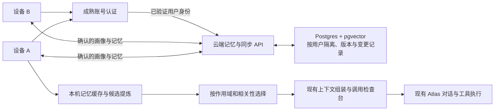

# 云端用户建模与个性化对话

2026-11-03。调研 #237 已完成，用户已采纳下述技术方案；总需求 #238 保持实施中。目前用户尚无 Supabase 项目，按其选择先交付接入与部署配置（#241），见 [部署包](../supabase/README.md) 和 [ADR 0040](adr/0040-cloud-personalization-boundary.md)。部署准备不等于客户端已支持云账号或跨设备同步，本轮不创建云资源、真实账号或上传现有用户资料。

## 已确认的需求与待定项

用户明确首版就支持云端多账户和跨设备，同步用户画像、偏好、已确认长期记忆。完整聊天历史、本地项目文件、模型及飞书凭据不自动同步。既有记忆检查台继续展示模型实际收到的完整上下文，并提供预览与独立试验。

用户已确认首版采用实用画像：可解释的沟通偏好、知识背景、长期目标与记忆，包含适用的项目上下文。情绪只用于当前会话，不保存为长期画像；长期性格推断留作后续可选能力。用户主动声明并确认的自我描述可以作为普通事实，这不等于自动推断性格。云服务地域/运维方式、登录渠道及费用策略待实施契约确定。

## 已采纳的技术方向

首版采用 **Supabase Auth + PostgreSQL/pgvector + LangMem 的结构化画像/事实提炼原语**。保留 tebb 的记忆服务拥有证据、候选确认、作用域、版本和删除语义，保留 Atlas 执行对话和工具。LangMem 返回的提炼结果先进入候选流程，不直接改写已确认画像，也不引入第二套 Agent。

该选择尚不代表 tebb 已验证组件适配或性能。先做 SDK/模型传输适配与评测小样，确认能复用现有模型连接、预算和发送边界记录；不能因为官方示例能跑就宣布兼容。若 LangMem 的依赖与适配成本不合适，Mem0 OSS 是首个对照候选，不同时运行两个独立记忆管理系统。

首版先使用检索式个性化：选择当前账号、当前范围内有效的画像/记忆，为一次回答提供相关背景。这样用户更正后可以在下一次请求核对结果。没有逐用户训练模型的前置要求。

## 可参考的现有技术

| 技术 | 官方资料确认的能力 | tebb 的建议与限制 |
| --- | --- | --- |
| [LangMem：用户档案](https://langchain-ai.github.io/langmem/guides/manage_user_profile/) / [项目](https://github.com/langchain-ai/langmem) | 结构化单档案、语义事实集合、后台提炼；核心原语可配合自有存储，另有 LangGraph 集成 | 最贴近可审阅画像与事实分开的需求。使用核心原语，原 Atlas Agent 不替换；用户命名空间不能代替身份鉴权。 |
| [Mem0 OSS](https://docs.mem0.ai/open-source/overview) / [项目](https://github.com/mem0ai/mem0) | SDK 或自托管服务，支持用户/会话/Agent 记忆；自托管服务提供 Postgres/pgvector 配置 | 适合快速验证现成记忆引擎。其自动写入/时序策略须与 tebb 的确认、冲突、遗忘和来源契约逐项核对；托管榜单含专有优化，不等于 OSS 在 tebb 的效果。 |
| [Graphiti](https://help.getzep.com/graphiti/getting-started/welcome) | 逐步更新的时态知识图谱，关系和事实可随来源变化，支持混合检索 | 适合以后出现较多人物/项目关系及时间推理需求时评估。首版实用画像不必额外运维图数据库。 |
| [PersonaMem-v3](https://arxiv.org/abs/2608.21381) / [v2](https://arxiv.org/abs/2512.06688) | 跨场景用户理解、隐含偏好、偏好演变、响应个性化及避免过度个性化的研究评测 | 是任务/评测参考，不是登录、存储或同步服务。不能把论文结果当成 tebb 的产品保证，也不能据此假定人格推断已经可靠。 |
| [LongMemEval](https://arxiv.org/abs/2410.10813) | 信息提取、跨会话及时间推理、知识更新、信息不足时不编造的评测 | 用来补齐仅测试“记住某句话”的盲点，结合现有任务质量验收入口。 |

LangMem 官方示例确实覆盖语言、时区、表达正式程度、细节层次与专业背景。Graphiti 提供时态关系模型。Mem0 当前公开资料同时描述开源 SDK 与托管实现，具体功能、默认组件和写入算法需要按实施时固定的版本验证，不以旧教程假设替代选型。

## tebb 当前缺口

当前 `facts.py` 的 user 作用域是当前本机数据目录内全局：`owner` 为空，不是云端账号；`memory_selection.py` 会选择全部有效的相符条目，没有语义相关性排序。`memory/facts.json` 没有按账号隔离的身份。协作中的 sync 是本地状态差量，不是跨设备同步。`BackendInfo` 的 token 认证一个本机进程，也不是人类用户的登录身份。

当前飞书只接收绑定 owner 的私聊消息；已核实的 `(app_id, brand, open_id)` 可以作为未来身份关联证据，但不是 tebb 云端账号。不能按名字、昵称或相同会话标题自动合并用户。伙伴的 personality 是 AI 伙伴人设，不能拿来保存对人类用户的性格判断。

已经可复用：候选/确认/撤销/到期、明确更正、版本检查与幂等操作、来源记录、run 的冻结记忆快照，以及“已发送 / 下次预览 / 独立试验”。当前的遗忘契约也要延续：停用一条记忆，不等于原聊天、摘要和历史模型请求副本都已经清除。

代码依据：[facts.py](../desk_companion/facts.py)、[memory_selection.py](../desk_companion/memory_selection.py)、[memory_inspector.py](../desk_companion/memory_inspector.py)、[context_sources.py](../desk_companion/context_sources.py)、[collaboration.py](../desk_companion/collaboration.py)、[feishu_agent.py](../desk_companion/feishu_agent.py)、[feishu_auth.py](../desk_companion/feishu_auth.py)。

## 首版结构与数据边界

账号认证复用 [Supabase Auth](https://supabase.com/docs/guides/auth)。接入准备采用托管项目、[邮箱验证码](https://supabase.com/docs/guides/auth/auth-email-passwordless)；没有浏览器回调的首版不增加深链服务。后续如启用 OAuth/链接登录，使用 [PKCE](https://supabase.com/docs/guides/auth/sessions/pkce-flow) 和受控回调。密码、验证与令牌机制由成熟服务负责；客户端不需要为登录安装 Docker。

云端 API 只提供画像、已确认记忆和同步能力；现有本机文件、终端、系统操作 RPC 继续留在本机。服务端从已验证令牌得到用户身份，不能相信模型或请求体任意填写的 user_id。数据库使用 [RLS](https://supabase.com/features/row-level-security) 及明确的用户/业务作用域约束；[向量查询也要遵守同样权限](https://supabase.com/docs/guides/ai/rag-with-permissions)。RLS 不是自动保证：服务密钥不能下发客户端，后台工作进程的身份、数据库角色及函数同样须核对。

**账号隔离先于画像功能。** 本机的记忆缓存、聊天、任务、调试记录、模型运行时状态及待同步队列都要归属账号。一次任务冻结原账号，不能在切换账号后把迟到结果写进新用户。推荐切换前停止新任务准入，完成或取消原工作并核对退出；未知外部回执仍留在原账号，不重放。云端账号切换与本地数据目录隔离须一起验收。

**云端权威记录，本机缓存。** 已确认的同步画像/记忆以云端版本为准，本机保存可离线读取的缓存与待同步操作，不让 facts.json 与新引擎各自写一份权威记忆再重复注入。当前无账号数据需先预览并明确选择归属，不能将旧全局数据默认认领给首个登录账号。

**范围严格遵守已确认选择。** 候选提炼在本机复用现有模型连接与任务预算，云端仅收到确认后的画像/偏好/记忆。云端不自动收集完整聊天，也不为“补齐来源链接”上传聊天原文、项目文件、API Key 或飞书凭据。来源同步稳定引用、时间和版本；另一设备拿不到原文时显示“来源在其他设备”。如将来采用云端提炼，需要另行说明新增上传的数据，不能把它当成当前范围已经包含。

## 画像、记忆与短期状态

| 类别 | 建议内容 | 生命周期与采用方式 |
| --- | --- | --- |
| 用户画像 | 语言、时区、回答详略、代码示例偏好、用户确认的知识背景 | 小型结构化档案；按字段保留来源与版本，用户可更正或停用 |
| 长期记忆 | 已确认目标、约束、兴趣、项目相关背景 | 按账号及项目/伙伴/会话范围存取，检索相关条目；失效或矛盾可见 |
| 本轮状态 | 这次要详细、时间紧、当前困惑、正在执行的目标 | 优先服务本轮，不自动当成长期偏好；可有短期有效范围 |
| 后续可选性格推断 | 本期不启用长期性格推断；情绪仅作用于当前会话 | 后续单独设计启用与确认机制，不把一次情绪等同性格；主动确认的自我描述作为普通事实处理 |

每条可持久化信息至少保留所属账号、业务范围、来源、提炼/确认方式、生效与到期、版本和状态。模型给出的 confidence 不是经校准的正确概率，不作为跨用户授权或自动确认依据。提到朋友/同事的事实也不能自动存成用户自己的属性。

优先顺序建议：本轮明确要求 > 当前适用的项目/会话约束 > 已确认用户偏好 > 待核实推断。偏好不是系统规则或外部操作授权。提炼不改变模型工具权限，助手自称“已完成”的话也不能自动成为用户背景或业务事实。

## 同步、更正与删除

- 每次编辑携带预期版本及稳定操作编号；服务端从账号身份决定归属。重复提交返回同一结果，断连先查询原操作。
- 设备使用按账号的变更游标和持久 outbox。并发冲突先保留两端意图，返回明确冲突；不依赖本机时钟静默选“最新一句”。
- 用户明确更正可以替代指定旧值；上下文不同的偏好应保留范围，不能把“这次展开说明”改成全局长篇偏好。
- 删除/撤销产生同步墓碑，旧设备及旧待同步写入不能把内容复活。记录需要核对的设备/索引/缓存清理状态；历史请求快照、原聊天与服务商副本分别说明。
- 向量索引是可重建派生数据，按原记录 ID 与版本更新；检索后在生成前再次核对原记录的归属、状态及版本，不能让已删除/过期条目因索引迟到而进入请求。

## 个性化对话与调试

不把整个画像库无差别塞入提示词。先按已验证账号与业务范围隔离，再按相关性、有效期、冲突与请求容量选择。每次运行冻结所选画像/记忆版本；后台画像更新只影响后续调用。

继续使用现有记忆检查台，增加账号/设备、画像字段、候选状态、同步状态与冲突提示。通过卡片及筛选定位语言/表达、背景、目标等信息；详情展开来源与原文，不新增一整页无法定位重点的文字。

“已发送”必须对得上真实 HTTP 请求；“下次预览”复用真实组装器，显示采用/排除原因和版本；“独立试验”比较启用或停用一组个人记忆的真实效果，不写回生产画像，不登记真实外部写入工具。查询记忆不证明模型实际使用了记忆，最终验收要同时检查请求与任务结果。

## 开发顺序与验收建议

1. **身份与隔离**：账号登录、设备、账号目录和任务身份；至少两账号两设备，覆盖伪造 user_id、缓存及迟到任务结果越界、注销与令牌失效。
2. **同步与生命周期**：画像/记忆版本、确认、更正、断连重试、离线冲突、删除防复活，以及明确的旧本机数据归属。
3. **候选提炼与相关性**：固定合成对话比较 LangMem 原语和 Mem0 OSS 候选；保持相同输入、模型、预算和验收，不以厂商榜单替代实测。记录错记、漏记、错误归属、矛盾处理、检索相关性、额外调用和耗时。
4. **实际对话效果**：在现有 `eval_agent.py` / `memory_*` 评测与记忆调试基础上扩展云端账号场景（尚未实现新参数）。同一问题在不同偏好下应满足各自要求，偏好更正影响下次请求，无关问题不强行个性化，信息不足时不编造画像。先假模型，再在明确的隔离配置和调用预算下做有限真实模型验证。

硬性边界为账号/作用域不串用、不能自动扩大权限、已停用或删除内容不再次生效、不会以候选推断冒充确认事实。模型效果、同步延迟、额外调用/成本及冲突处理结果分开记录。本文不承诺尚未测量的准确率或性能。

## 已确认范围与后续技术验证

实用画像、可解释长期记忆、云端多账户与跨设备同步的首版范围已获用户确认，情绪仅用于当前会话，长期性格推断后续可选。接下来需通过小样核实 LangMem 原语与既有 Atlas 模型传输的适配成本，再锁定 SDK 版本。托管 Supabase 和邮箱验证码作为接入方向；实际项目地域、登录态保存及真实数据保留策略在后续集成中确定，不在本轮自动部署。

下一阶段 #244 的客户端登录、本机账号空间及重启边界见 [账号说明](ACCOUNTS.md) 和 [ADR 0041](adr/0041-account-bound-processes.md)。保留原本机空间，不自动认领；云端 outbox/同步及 LangMem 继续由 #238 推进。

2026-11-04 进展：#255 已落地确认资料卡片、事务存储与离线队列、明确冲突处理、删除围栏、后台同步和记忆检查台接入，并部署真实 Supabase 项目完成两个账号、三个独立资料副本验收。详见 [同步模块](PERSONALIZATION_SYNC.md)；SMTP、两台实体设备与实际模型个性化效果仍分别待验收，候选提炼与相关性选择是 #238 后续阶段。
