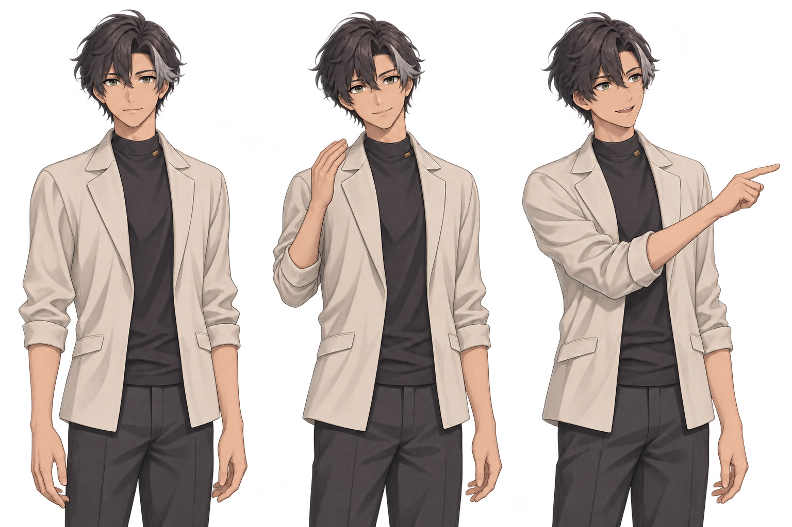

# 第二版人物原画评审

2026-11-05，关联 [#277](https://github.com/lkun-lea/tebb/issues/277)，后续模型实施仍由 [#272](https://github.com/lkun-lea/tebb/issues/272) 跟踪。

**状态：待用户评审。仅为静态角色与姿态设计，不是已绑定的 Live2D 模型，不代表动作或客户端验收通过。** 本轮没有修改客户端。

## 本轮设计

以原创、知性的成人半身立绘作为第一件样稿，采用炭灰、象牙白和少量低饱和金色；细线与克制的赛璐璐阴影，背景透明。角色外观用于画像展示，不据此推断用户的真实长相或性别。

从左到右为放松站姿、小幅招手、侧向指引。三种姿势均按完整角色绘制，先检查头颈、肩肘腕、掌背和拇指方向，再决定是否进入拆件和绑定。旧角色的独立部件图不作为本版原画来源。

评审关注：

- 造型是否愿意长期展示在个人画像页，缩小时脸部与整体轮廓是否清楚。
- 衣袖、肩部、手腕和手部在三个完整姿势中是否协调；招手和指引是否自然。
- 是否接受这种立绘完成度与配色作为后续多形象的制作方向。

三种姿态是静态设定，不能说明抬手、收手和切换过程已自然。用户确认后仍需制作分层原画、遮挡补绘、Cubism 编辑工程与真实运行样件，并按 [重设计提案](../LIVE2D_REDESIGN.md) 验收运动连接。机器人与小兔的选择需求保留，待首个样件标准确认后扩展。

## 来源与保存

使用 OpenAI 内置 `image_gen` 生成；未使用 CLI 或自建图片 API。生成未引用第三方角色图、模型或纹理。完整提示保存在 [PROMPT.txt](PROMPT.txt)，原图保留透明通道，无黄色光晕背景。

## 小幅动态概念

2026-11-05，关联 [#278](https://github.com/lkun-lea/tebb/issues/278)。[直接打开预览](motion.html)，[可编辑源](motion.fragment.html)。预览不修改客户端，不连接模型、账号或外部接口。

基于本页完整原画进行连续的小幅网格形变，演示呼吸、轻点头、已抬手姿势内的手腕轻摆与指引停留。网格保持完整画面，未把旧分层部件重新拼回人物；内嵌纹理仅对原画等比缩小至 864×576，保留透明通道，未重新生成手型。

**这不是正式 Live2D，也不是完整动作样件。** 动作选择直接换到相应完整姿态，不演示不同姿态之间的抬手和收手；没有制作眼口替换、转头的立体校形或遮挡补绘。不能用本预览验收正式模型的关节连接和动作过渡。

支持播放/暂停、系统减少动态效果与离开可见区域暂停；播放环境不可用或中断时，明确显示原因并回到静态姿态。预览帧内可读取 `document.getElementById('tebb-profile-v2-motion').motionReviewSnapshot()`，查询当前动作、播放状态、已绘制次数、减少动态效果与不可用原因；此入口不写业务数据。

隔离的无界面 Edge 已验证：加载、实际像素随时间变化、四个动作选择、暂停后时钟与像素保持、减少动态效果、320px 无水平溢出、深色显示、WebGL 中断后的静态降级。静态截图已检查透明背景与布局。未验证正式 Live2D 模型、抬手/收手、原生 WebView 帧率及用户视觉验收；不以绘制次数宣称帧率达标。

### 肩部复审与修订

2026-11-05 用户指出招手拉扯肩膀，关联 [#279](https://github.com/lkun-lea/tebb/issues/279)。上一版整条前臂运动的影响范围包含肩部与衣服；交互和整图像素变化检查没有覆盖这项视觉缺陷，上一版不能视为动作质量通过。

本次撤掉招手的整臂摆动，收敛为手腕附近的轻摆，排除肩线、袖口与躯干；同时移除横向拉宽衣服的呼吸变形，缩短头部影响范围，避免它带动抬手的指尖。原画、手型和客户端不变。手腕预览不能替代正式模型里的完整招手。

提供独立的实际画面检查脚本 [check-shoulder.js](check-shoulder.js)：打开预览，在浏览器开发者工具选择该预览帧，执行文件内容。脚本会暂停到手腕轻摆姿态，在相同时间、相同原画与呼吸状态下，切换真实着色器的手势开关并读取像素；结束后可点击播放继续。返回 `passed/failed`、保护区域是否稳定、手部是否运动以及各时间点的差异；渲染不可用时明确报错，不以跳过当成功。

修复前复现：0.5 秒时肩部样区有 1447 个像素、躯干样区有 478 个像素因手势变化。修复后在 0～3.5 秒、每隔 0.5 秒的 8 个时间点，肩部、另一侧肩部、袖口与躯干样区的最大通道差均为 0，手部样区仍有变化。隔离 Edge 同时重跑上述交互检查通过。该检查只覆盖明确的样区和时间点，不替代整套模型的美术审查。
